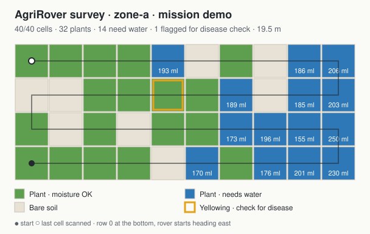
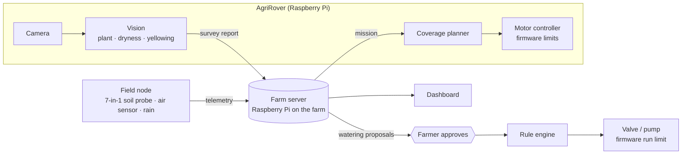

# AgriRover — AI survey rover for smart farms

**One Utilities Cambodia** · Siem Reap
Cambodia Digital Awards 2026 · *Digital Research & Innovation*

AgriRover drives along a farm bed cell by cell, photographs every plant, and
tells the farmer which plants need water and which are yellowing — with every
suggested action waiting for the farmer's approval. Everything runs on the farm
(Raspberry Pi, no cloud, works without internet), on top of the **AI Auto Farm**
platform: field sensors, automatic irrigation, a rule engine and a dashboard.

<p align="center"></p>
<p align="center"><sub>One simulated survey (<code>python -m rover sim</code>): 40 cells scanned, 32 plants, 14 need water with the amount proposed for each, 1 flagged for a disease check.</sub></p>

## Why

- Small farms check crops by walking every row; problems are seen late.
- Whole-bed watering on a timer wastes water where the soil is already wet.
- Rural internet is weak; cloud-only tools stop working when it drops.

## How it works



## Safety by design

Intelligence is added at the top, where it is safe; each layer below is simpler
and can always stop the one above it.

| Layer | Guarantee |
|---|---|
| Firmware (field node, rover motor controller) | Every valve run and every wheel run is time-limited in firmware; the rover also stops on its bumper and on a lost link. Nothing upstream can override it. |
| Rule engine | Waters only on threshold, never in rain, never after dark (solar pump), with cooldown. Works with no AI and no network. |
| Rover guards | E-stop, rain, low battery and lost link stop a survey before the next move; the rover always ends stopped. |
| AI | Reads everything, *proposes* only. A named person approves every action. |

Details: [control hierarchy](docs/architecture/control-hierarchy.md) · [rover design](docs/architecture/rover.md)

## Status

| Part | Path | Status |
|---|---|---|
| Rover agent — planner, vision, missions, guards, MQTT | `edge/rover-agent` | **Working in simulation** · 65 tests |
| Rover motor-controller firmware + serial protocol | `edge/rover-motor-controller` | **Written and host-tested** · not yet on the chassis |
| Rover hardware — chassis, motors, camera | — | Under construction |
| Field node — soil, rain, pH, 4 relays, run-time interlock | `edge/esp8266-field-node` | **Implemented** |
| Irrigation rule engine | `apps/api/app/services/rule_engine.py` | **Implemented** · tested |
| Stage-aware crop conditions and alerts (advice only) | `apps/api/app/services/agronomy.py` | **Implemented** · tested |
| 7-in-1 soil probe and air sensor: ingest, history, ribbon | `apps/api/app/services/metrics.py` | **Implemented** · firmware reader not written |
| Growing setups and yield forecast, symptom cross-check | `apps/api/app/services/setups.py`, `diagnosis.py` | **Implemented** · tested |
| Mission API `POST /api/v1/missions` | `apps/api/app/routers/missions.py` | **Implemented** · tested |
| AI assistant — propose / approve | `apps/api/app/services/assistant.py` | Safety checks implemented; model wiring in progress |
| Disease model — MobileNetV2, tomato leaves | `rover/vision.py` (adapter) | Prototype; model file not in this repo |
| Database persistence, dashboard | `apps/api`, `apps/web` | Schema complete; in progress |

## Try it — no hardware needed

```bash
cd edge/rover-agent
pip install -r requirements.txt
python -m rover sim                  # survey a simulated 4 x 10 bed
python -m rover sim --battery 11.3   # watch the low-battery guard stop the rover safely
python -m pytest                     # rover tests
```

Output in `reports/<mission>/`: `report.json`, `field-map.svg`, and what the camera saw:

<p align="center"></p>

Full stack (farm server, broker, database, dashboard and a simulated rover):

```bash
cp .env.example .env                 # set the passwords
docker compose --profile sim up -d
curl -X POST localhost:8000/api/v1/missions -H "content-type: application/json" \
     -d '{"zoneId": "zone-a", "rows": 4, "cols": 10}'
docker compose logs -f rover-sim
docker compose logs -f field-sim   # simulated field node; SIM_SCENARIO=dry|wet|rain|heat|humid|salty and
                                   # SIM_PROBE=basic|7in1 in .env (7in1 adds the soil probe and air sensor)
```

Guava on sample data (no server, nothing saved): open `http://localhost:5173/?mock=guava`. See [docs/GUAVA-REQUIREMENTS.md](docs/GUAVA-REQUIREMENTS.md).

Platform tests: `cd apps/api && pip install -r requirements.txt && python -m pytest`
· Firmware protocol test: `cd edge/rover-motor-controller/test && g++ -std=c++11 -I.. test_drive_protocol.cpp -o t && ./t`

## Repository

```
edge/rover-agent            rover software (Python, Raspberry Pi)
edge/rover-motor-controller rover firmware (Arduino) + protocol test
edge/esp8266-field-node     field sensor / relay node firmware
apps/api                    farm server: FastAPI · PostgreSQL · MQTT · rule engine · missions
apps/web                    dashboard (React)
docs/                       architecture, rover design, screen designs
```

<p align="center"><br><sub>Dashboard design (mock data)</sub></p>

## Roadmap

1. Build and commission the rover; calibrate vision on a real bed.
2. Field pilot with partner farms: measure scouting time, water use and detection time against manual scouting.
3. Wheel encoders and IMU; GPS waypoints (ArduPilot Rover) for field-scale crops.
4. Train the disease model on a labelled image set of Cambodian crops collected by the rover.

## Team

One Utilities Cambodia — Siem Reap · [oneutilities.com](https://oneutilities.com) · info@oneutilities.com
Lead developer: Daivai Cheong. The farm platform began as his *AI Auto Farm* project.

© 2026 One Utilities Cambodia and Daivai Cheong. All rights reserved.
