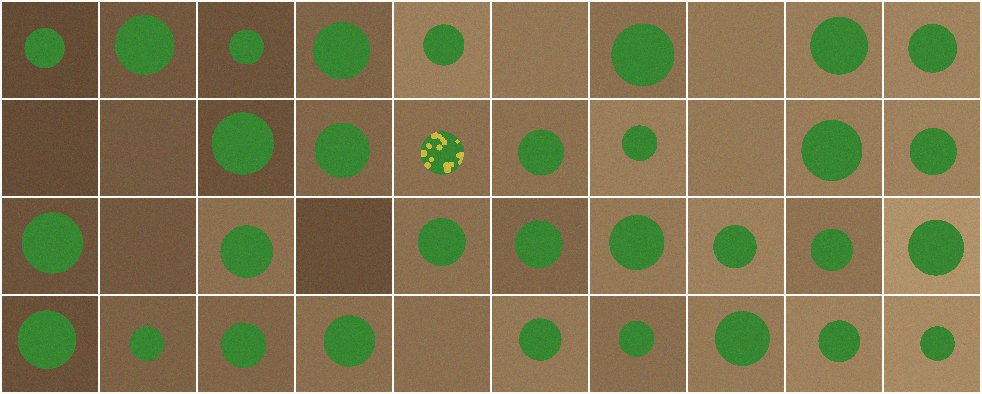
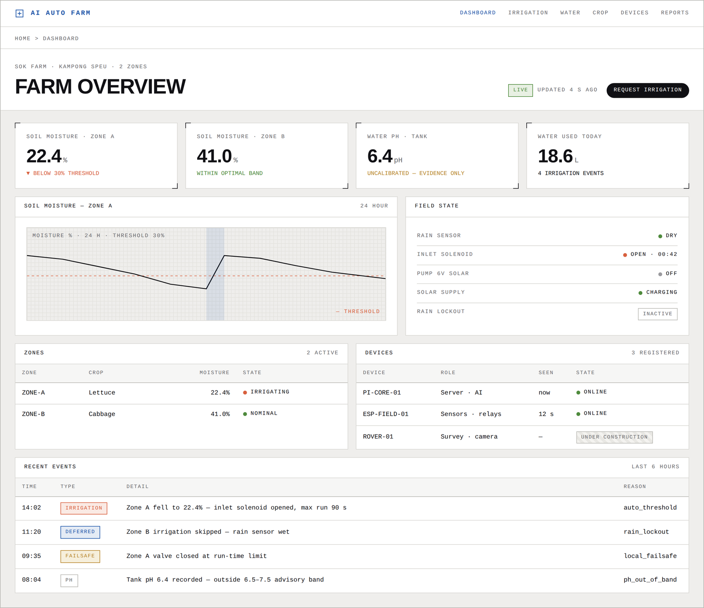

# AgriRover — AI survey rover for smart farms

**One Utilities Cambodia** · Siem Reap
Cambodia Digital Awards 2026 · *Digital Research & Innovation*

AgriRover goes to every guava tree every day. At each tree it reads the soil and air and photographs the tree. It then
tells the farmer what to do today: how much water for each tree, whether to feed, and which trees to go and look at.
A person always acts: the rover never waters or feeds. Everything runs on the farm (Raspberry Pi, no cloud, works without internet).

**Today it runs in simulation.** The rover's software is real; the wheels, camera, probe and orchard are simulated. The chassis is not built.

## Why

- Checking trees means walking every row, and problems are seen late.
- Too much fertiliser burns a tree; too little lowers the fruit's grade and taste.
- Water is given by the block on a habit, not by what each tree's soil and stage need.
- Rural internet is weak; cloud-only tools stop working when it drops.

Plan: [docs/PLAN.md](docs/PLAN.md) · Evidence: [docs/GUAVA-RESEARCH.md](docs/GUAVA-RESEARCH.md) · Procedure: [docs/ROVER-SOP.md](docs/ROVER-SOP.md)

## Status

| Part | Path | Status |
|---|---|---|
| Rover agent: tree-by-tree round, vision, guards, MQTT | `edge/rover-agent` | **Working in simulation** · tested |
| Rover motor-controller firmware + serial protocol | `edge/rover-motor-controller` | **Written and host-tested** · not on a chassis |
| Rover hardware: chassis, GNSS and LiDAR, mast camera, probe arm | [rover design](docs/architecture/rover.md) | **To build** |
| 7-in-1 soil probe reader | `edge/rover-agent/rover/probe.py` | Not written: needs the probe's datasheet |
| Guava stages, rules, tasks, setups | `apps/api/app/services/guava.py` | **Implemented** · numbers from the guava document, not checked |
| Daily advice: water per tree, feed, growth | `apps/api/app/services/advisor.py` | **Implemented** · tested · starting rules, no field results |
| Rover screens: daily round, what it does, growth, SOP, history | `apps/web/src/pages/Rover*.tsx` | **Implemented** · against the simulated rover |
| Field node: rain, pH, 4 relays, run-time interlock | `edge/esp8266-field-node` | **Implemented** |
| Costs, harvest, cost per kg | `apps/api`, `apps/web` | **Implemented** · tested |
| Disease model | `rover/vision.py` (adapter) | Prototype on tomato leaves; no guava model; file not in this repo |

## Try it — no hardware needed

```bash
cd edge/rover-agent
pip install -r requirements.txt
python -m rover sim                  # survey a simulated 4 x 10 bed
python -m rover sim --battery 11.3   # watch the low-battery guard stop the rover safely
python -m pytest                     # rover tests
```

Output in `reports/<mission>/`: `report.json`, `field-map.svg`, and what the camera saw:

<p align="center"></p>

Full stack (farm server, broker, database, dashboard and a simulated rover):

```bash
cp .env.example .env                 # set the passwords
docker compose --profile sim up -d
# open http://localhost:5173/rover, tick the checks, start a round
docker compose logs -f rover-sim
docker compose logs -f field-sim   # the rain sensor; SIM_SCENARIO=rain in .env makes it rain
```

Platform tests: `cd apps/api && pip install -r requirements.txt && python -m pytest`
· Firmware protocol test: `cd edge/rover-motor-controller/test && g++ -std=c++11 -I.. test_drive_protocol.cpp -o t && ./t`

## Repository

```
edge/rover-agent            rover software (Python, Raspberry Pi)
edge/rover-motor-controller rover firmware (Arduino) + protocol test
edge/esp8266-field-node     field sensor / relay node firmware
apps/api                    farm server: FastAPI · PostgreSQL · MQTT · rule engine · missions
apps/web                    dashboard (React)
docs/                       architecture, rover design, screen designs
```

<p align="center"><br><sub>Dashboard design (mock data)</sub></p>

## Roadmap

See [docs/PLAN.md](docs/PLAN.md). First: test the probe on a table, then carry it by hand from tree to tree, before building a rover to carry it.

## Team

One Utilities Cambodia — Siem Reap · [oneutilities.com](https://oneutilities.com) · info@oneutilities.com
Lead developer: Daivai Cheong. The farm platform began as his *AI Auto Farm* project.

© 2026 One Utilities Cambodia and Daivai Cheong. All rights reserved.
