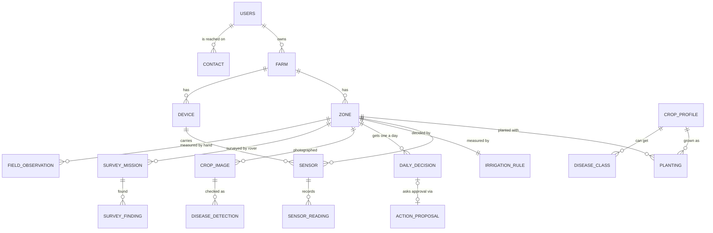

# AgriRover: what the system must remember (schema design)

Built as migration `0002` (20 tables). Example crop: **tomato**. Example numbers are illustrations, not agronomy advice.

## Status: what uses each new table today

| Table | Used by code now? |
|---|---|
| `planting`, `sensor`, `daily_decision`, `zone.label`, `zone.trial_arm`, `sensor_reading.sensor_id` | Yes: seed, ingest, decisions, daily message |
| `contact` | No. The Telegram chat id is still read from `.env`. Next to wire. |
| `disease_class` | No. Filled from the model's labels file when the model arrives. |
| `survey_finding` | No. Filled when rover results are stored (step S7). |
| `field_observation` | No. Needs a small entry form. |
| `daily_decision.done_at` / `done_seconds` | No. Needs a way for the farmer to say "I watered". |

## The idea in one line
Every morning, for each zone: read the soil, decide (water / skip), ask the farmer, record what they did. A phone photo can check a leaf. All of it is kept, so we can show the system works.

## What the system must remember (6 things)

| # | It must remember | Tables |
|---|---|---|
| 1 | Who the farmer is, where, what is planted | `users`, `contact`, `farm`, `zone`, `crop_profile`, `planting` |
| 2 | What the sensors say | `device`, `sensor`, `sensor_reading` |
| 3 | What the rule engine decided, and why | `irrigation_rule`, `daily_decision` |
| 4 | What the farmer answered and did | `action_proposal`, `daily_decision` (done fields), `audit_log` |
| 5 | What the camera saw | `crop_image`, `disease_detection`, `disease_class`, `survey_mission`, `survey_finding` |
| 6 | Proof it works (guided bed vs usual bed) | `zone.trial_arm`, `field_observation` |

## Diagram

## New tables (7)

**`contact`**: how to reach a person. Replaces the Telegram chat id that is now in `.env`, so more than one farmer can be served.
`user_id`, `channel` (telegram), `address` (chat id), `language` (km | en), `verified`.

**`planting`**: what is growing in a zone, and since when.
`zone_id`, `crop_id`, `variety`, `planted_on`, `ended_on`. "Day 21 of tomato" is calculated from `planted_on`.

**`sensor`**: one probe on a field node. The plan calls for probes at 2 depths, and today a reading does not say which probe it came from.
`device_id`, `zone_id`, `kind`, `depth_cm`, `calibration_dry`, `calibration_wet`, `used_for_decision` (which depth the rule engine reads).

**`daily_decision`**: the main record. One row per zone per day, for every outcome (not only "water"), so we can always answer "why did it say that?".
`zone_id`, `decision_date`, `decision` (the rule engine's outcome), `reason`, `duration_s`, `inputs` (the readings, threshold, rain and planting day it used), `message_sent_at`, `proposal_id`, `done_at`, `done_seconds` (what the farmer reports doing).
Unique on (`zone_id`, `decision_date`). The farmer's answer lives in `action_proposal`, not here, so it is stored once.

**`disease_class`**: the list of diseases the model can name, with a plain-language explanation.
`crop_id`, `code`, `name_en`, `name_km`, `advice`. Rows come from the model's labels file. The advice text must come from an agronomist, not from us.

**`survey_finding`**: one row per rover cell. Today the rover's report is only logged, then lost.
`mission_id`, `row`, `col`, `plant_present`, `needs_water`, `yellowing`, `disease_code`, `confidence`, `image_id`.

**`field_observation`**: numbers a person writes down by hand: minutes spent checking, plants lost, waterlogging, a note. This is the evidence for the 4-6 week comparison.
`zone_id`, `observed_on`, `kind`, `value`, `note`, `recorded_by`.

## Changed tables (3)

- **`zone`**: add `label` (what the farmer sees: "Tomato bed A", can be Khmer) and `trial_arm` (`guided` | `usual`). `name` stays as the short id used in MQTT topics.
- **`sensor_reading`**: add `sensor_id` (empty for rain and supply voltage, which belong to the device).
- **`users`**: no change. Language moves to `contact`.

## Deleted tables (2)

- `growth_record`: canopy cover and plant count belong to features we removed (yield prediction).
- `alert`: nothing writes to it. The Devices page already shows "silent" sensors.

## Kept (13 of today's 15; `zone` and `sensor_reading` are extended above)

`users`, `farm`, `crop_profile`, `zone`, `device`, `sensor_reading`, `irrigation_rule`, `irrigation_event` (reserved for the automatic valve, later), `action_proposal` (the Approve / Skip record from step S5), `crop_image`, `disease_detection`, `survey_mission`, `audit_log`.

Total after the change: 15 − 2 + 7 = **20 tables**.

## Tomato example: one morning

| Table | Row (illustration only) |
|---|---|
| `crop_profile` | tomato, preferred soil moisture 30-45 % (placeholder until calibrated on site) |
| `zone` | `zone-a`, label "Tomato bed A", arm `guided` · `zone-b`, "Tomato bed B", arm `usual` |
| `planting` | zone-a, tomato, planted 15 Oct 2026, so 4 Nov is **day 21** (the planting day is day 1) |
| `sensor` | `ESP-FIELD-01` carries a 10 cm probe and a 25 cm probe; the 25 cm probe is used for the decision |
| `sensor_reading` | 4 Nov 06:00, 25 cm probe, 25.8 % |
| `daily_decision` | 4 Nov, zone-a: **water 17 s**, reason `auto_threshold` (25.8 % is below 30 %) |
| `action_proposal` | sent on Telegram 06:05; farmer pressed Approve at 06:12 |
| `daily_decision` (done) | the farmer reports having watered for 17 s at 06:20 |
| `crop_image` + `disease_detection` | phone photo of a leaf; model says "late blight", 93 % confidence; the farmer's helper marks it confirmed or not |
| `field_observation` | 4 Nov, zone-b (usual bed): 25 minutes spent walking the rows to check |

What the farmer reads: **"Tomato bed A (day 21): water 17 s. Tomato bed B: skip, soil is wet enough."**

## Decisions I need from you

1. Build the schema as above, or smaller?
2. Daily message language: English first, or Khmer from the start?
3. Store disease photos on the farm server (needed to review and confirm results), or check and discard?
4. Which probe decides when two depths exist? The grower should confirm; I would start with the deeper one.
