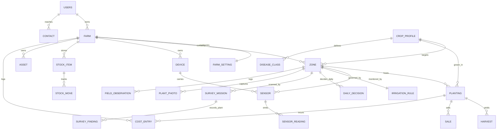

# AgriRover Database Schema & Backend Data Blueprint

PostgreSQL 16 schema design managed via SQLAlchemy 2 + Alembic (`apps/api/app/models/entities.py` and `apps/api/alembic/versions/`).

> **Important for Backend & CI:** Currently, migrations `0001`–`0010` are implemented in `apps/api/alembic/versions/` and must stay in strict parity with `apps/api/app/models/entities.py` (`test_migrations.py` checks `compare_metadata == []`).
> Section 1–2 below documents the **implemented schema (`0001`–`0010`)**, and Section 3 specifies the **`0011` Tomato Platform Migration Blueprint** to align the backend database & seed data with the Tomato frontend on `main`.

---

## 1. Migration Chain (`0001` – `0010`)

| Revision | Purpose | Key Tables / Columns Added |
|---|---|---|
| `0001` | Core farm & irrigation MVP | `users`, `farm`, `crop_profile`, `zone`, `device`, `sensor_reading`, `irrigation_rule`, `irrigation_event`, `action_proposal`, `crop_image`, `disease_detection`, `survey_mission`, `audit_log` |
| `0002` | Expanded daily advisory & trial model | Adds `contact`, `planting`, `sensor`, `daily_decision`, `disease_class`, `survey_finding`, `field_observation`; extends `zone` (`label`, `trial_arm`), `sensor_reading` (`sensor_id`); drops unused `growth_record` and `alert` |
| `0003` | Cost of production & ERP ledger | Adds `orchard_job_done`, `farm_setting`, `stock_item`, `stock_move`, `cost_entry`, `asset`, `harvest`, `sale` + `crop_profile` FAO-56 `Kc`/stage columns + `planting` cycle cost columns |
| `0004` | Settings cleanup | Drops unused `et0` column from `farm_setting` |
| `0005` | 7-in-1 soil probe, air metrics & fast time index | Extends `metric_type` enum (`soil_ph`, `soil_ec`, `soil_temperature`, `nitrogen`, `phosphorus`, `potassium`, `air_temperature`, `air_humidity`); adds composite `ix_sensor_reading_zone_metric_time` index on `(zone_id, metric, recorded_at)`; adds `planting.setup` & `expected_price_usd_per_kg` |
| `0006` | Rover mission geometry & report metadata | Adds `rows`, `cols`, `cell_m`, `abort_reason`, `cells_flagged`, `distance_m`, `est_duration_s`, `simulated` to `survey_mission` |
| `0007` | Per-plant rover telemetry & JSONB readings | Adds `canopy`, JSONB `readings`, and `flagged` to `survey_finding` |
| `0008` | Saved plant photos & triage workflow | Adds `plant_photo` storing image URI, probe snapshot, `model_label`, `farmer_label`, `expert_label` |
| `0009` | Sample data separation | Adds `sample` boolean flag to `cost_entry`, `harvest`, `sale` |
| `0010` | Lab leaf nutrient records | Adds `leaf_sample` and `leaf_result` (`sample_id`, `nutrient`, `source`, `value`, `unit`) |

---

## 2. Implemented Entity-Relationship Overview (29 Tables)



### Key Table Groups in `entities.py`

1. **Farm, Users & Auth (`users`, `contact`, `farm`, `farm_setting`, `audit_log`):**
   - `farm_setting` stores `khr_per_usd` (default `4000`, tomato benchmark `4085`), `family_wage_usd_per_day`, `water_cost_per_m3_usd`, `land_rent_usd_per_ha_year`, `irrigation_efficiency`.
2. **Crop, Beds & Sensors (`crop_profile`, `zone`, `planting`, `device`, `sensor`, `sensor_reading`):**
   - `sensor_reading` stores telemetry from both fixed ESP nodes (`rain`, `supply_voltage`, `water_ph`) and rover probes (`soil_moisture`, `soil_ph`, `soil_ec`, `soil_temperature`, `nitrogen`, `phosphorus`, `potassium`, `air_temperature`, `air_humidity`).
   - **Critical Index (`ix_sensor_reading_zone_metric_time`):** Leading `(zone_id, metric, recorded_at)` index replaces plain `recorded_at` so "latest reading of metric X in bed Y" remains `< 20 ms` at scale. Never add a standalone `recorded_at` index (`test_migrations.py` enforces this).
3. **Autonomous Rover & Vision (`survey_mission`, `survey_finding`, `plant_photo`, `crop_image`, `disease_detection`, `disease_class`):**
   - `survey_mission`: tracks row/col grid, `cell_m`, `cells_scanned`, `plants_detected`, `cells_flagged`, `distance_m`, `est_duration_s`, `simulated`, `status`.
   - `survey_finding`: one row per grid plant (`cell_row`, `cell_col`, `plant_present`, `needs_water`, `canopy`, `yellowing`, `disease_code`, `confidence`, `flagged`, and JSONB `readings`).
   - `plant_photo`: photo triage archive (`zone_id`, `tree_row`, `tree_col`, `readings` JSONB, `model_label`, `expert_label`).
4. **Irrigation Decisions & Scheduling (`irrigation_rule`, `irrigation_event`, `daily_decision`, `action_proposal`, `orchard_job_done`):**
   - `daily_decision`: unique per `(zone_id, decision_date)`, records exact decision, duration, JSON `inputs`, Telegram `message_sent_at`, and farmer `done_at`.
5. **Unit Economics & ERP (`stock_item`, `stock_move`, `cost_entry`, `asset`, `harvest`, `sale`):**
   - `cost_entry`: farm & block ledger in USD/KHR with `rate_used`, `amount_usd`, `source` (`manual` | `stock_use`), soft-delete `deleted_at`, and `sample` flag.
   - `harvest` & `sale`: tracks `kg_total`, `kg_marketable`, `kg_home`, `price_per_kg`, `currency` (`USD` | `KHR`), `buyer`.

---

## 3. Recommended Migration `0011`: Tomato Backend & AI Vision Alignment

To bring PostgreSQL & FastAPI into 100% parity with the upgraded Tomato frontend on `main`, implement migration **`0011_tomato_platform.py`** alongside corresponding updates in `entities.py`, `services/seed.py`, and API routers:

### A. Tomato Crop Profile & `G1–G6` Target Calibration
1. **Update `crop_profile` (`slug = 'tomato'`):**
   - `common_name = 'Tomato'`, `scientific_name = 'Solanum lycopersicum'`
   - `opt_moisture_min_pct = 58.00`, `opt_moisture_max_pct = 72.00`, `growth_duration_days = 120`
   - Optional extended target columns (or JSONB `targets` on `crop_profile`):
     ```sql
     ALTER TABLE crop_profile
       ADD COLUMN IF NOT EXISTS opt_ph_min NUMERIC(4,2) DEFAULT 6.00,
       ADD COLUMN IF NOT EXISTS opt_ph_max NUMERIC(4,2) DEFAULT 6.80,
       ADD COLUMN IF NOT EXISTS opt_ec_min NUMERIC(4,2) DEFAULT 0.80,
       ADD COLUMN IF NOT EXISTS opt_ec_max NUMERIC(4,2) DEFAULT 2.50,
       ADD COLUMN IF NOT EXISTS opt_soil_temp_min NUMERIC(4,1) DEFAULT 18.0,
       ADD COLUMN IF NOT EXISTS opt_soil_temp_max NUMERIC(4,1) DEFAULT 29.0,
       ADD COLUMN IF NOT EXISTS opt_n_min_mg_kg INTEGER DEFAULT 80;
     ```
2. **Seeded `zone` & `planting` records (`G1–G6`):**
   - `g1`: `G1 Greenhouse North` (`400 m²`, `Roma Tomato`, `15` active plants, `4x4` grid with empty `[3,3]`)
   - `g2`: `G2 Commercial Bed A` (`105 m²`, `Cherry Belle`, `10` active plants, `2x5` grid)
   - `g3`: `G3 Raised Beds B` (`60 m²`, `San Marzano`, `10` active plants, `2x5` grid)
   - `g4`: `G4 Drip Plot C` (`50 m²`, `Beefsteak`, `24` active plants, `5x5` grid with empty `[0,4]`)
   - `g5`: `G5 Harvest Bed` (`105 m²`, `Roma Tomato`, `10` active plants, `2x5` grid)
   - `g6`: `G6 Open Field` (`50 m²`, ready / `0` active plantings)

### B. AI Vision Bounding Boxes & Plant Care Extensions (`survey_finding`)
Extend `survey_finding` to store structured tomato detection outputs expected by `apps/web/src/lib/vision.ts` and `RoverVisionPhoto.tsx`:

```sql
ALTER TABLE survey_finding
  ADD COLUMN IF NOT EXISTS growth_stage VARCHAR(48),
  ADD COLUMN IF NOT EXISTS fruit_count SMALLINT,
  ADD COLUMN IF NOT EXISTS linked_note TEXT,
  ADD COLUMN IF NOT EXISTS vision_boxes JSONB;
```

**Expected `vision_boxes` JSONB array element format:**
```json
[
  { "id": "foliage", "kind": "foliage", "label": "Tomato canopy 97%", "confidencePct": 97, "x": 10, "y": 15, "w": 76, "h": 58 },
  { "id": "fruit",   "kind": "fruit",   "label": "Green tomato (3) 95%", "confidencePct": 95, "x": 24, "y": 38, "w": 22, "h": 22 },
  { "id": "issue",   "kind": "issue",   "label": "Curled upper leaf 88%", "confidencePct": 88, "x": 52, "y": 20, "w": 30, "h": 24 }
]
```
Standardized `disease_code` values consumed by `vision.ts` & `treatments.ts`:
- `early_blight` | `leaf_curl` | `chlorosis` (or `yellow_leaves`) | `blossom_end_rot` | `pest_damage`

### C. Structured 4-Step Treatments (`disease_class`)
Extend `disease_class` so the database stores symptoms, causes, numbered 4-step treatments, and prevention matching `apps/web/src/lib/treatments.ts`:

```sql
ALTER TABLE disease_class
  ADD COLUMN IF NOT EXISTS severity_hint VARCHAR(80),
  ADD COLUMN IF NOT EXISTS symptoms TEXT,
  ADD COLUMN IF NOT EXISTS causes TEXT,
  ADD COLUMN IF NOT EXISTS steps JSONB,
  ADD COLUMN IF NOT EXISTS prevention TEXT;
```

**Expected `steps` JSONB array:**
```json
[
  { "step": 1, "label": "Immediate Field Action (Today)", "action": "..." },
  { "step": 2, "label": "Soil / Irrigation Adjustment", "action": "..." },
  { "step": 3, "label": "Targeted Treatment Method (Organic & Standard Options)", "action": "..." },
  { "step": 4, "label": "Follow-Up Check", "action": "..." }
]
```

### D. Per-Plant Unit Cost Benchmarks (`farm_setting` / `zone` / `planting`)
To back `/finance` (`Unit Cost & Savings`, `Block Breakdown`, `Harvest & Revenue`) dynamically from Postgres:
- Set default `farm_setting.khr_per_usd = 4085.00`, `rate_confirmed = true`.
- Set `planting.expected_price_usd_per_kg = 0.80` (with benchmark `~4.5 kg/plant` expected yield and `$0.75/plant` operational budget split into water `$0.06`, nutrients `$0.18`, treatment `$0.09`, seedling/labor `$0.42`).
- Record soil texture, rooting depth, and drainage per zone if persisted server-side (currently defaulted cleanly per block in `apps/web/src/lib/soil.ts` + `localStorage`):
  ```sql
  ALTER TABLE zone
    ADD COLUMN IF NOT EXISTS soil_texture VARCHAR(32) DEFAULT 'Loam',
    ADD COLUMN IF NOT EXISTS rooting_depth_cm SMALLINT DEFAULT 55,
    ADD COLUMN IF NOT EXISTS drainage VARCHAR(32) DEFAULT 'Well drained',
    ADD COLUMN IF NOT EXISTS organic_matter_pct NUMERIC(4,2) DEFAULT 2.80;
  ```

> Remember: whenever you edit `apps/api/app/models/entities.py`, generate an Alembic revision and verify **`pytest tests/test_migrations.py`** against Postgres so `compare_metadata` produces `[]`.
