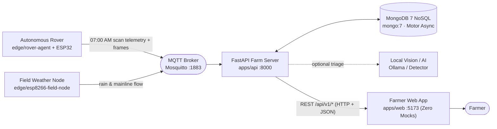

# AgriRover: End-to-End Tomato Platform Workflow

How AgriRover works end to end on `main`: autonomous morning rover monitoring, 3D CAD visualization, live soil telemetry paired with tomato AI vision, **Mulder's Chart Fast-Focus treatments & formula prescriptions**, an **interactive Excel Financial Calculator**, and full persistence in **FastAPI + MongoDB 7 (NoSQL)**.

**Contents:** [What AgriRover Is](#what-agrirover-is) · [Core Value Proposition](#core-value-proposition) · [System Architecture](#system-architecture) · [Farmer UI Workflow](#farmer-ui-workflow) · [Live-Telemetry Care Logic](#live-telemetry-care-logic) · [Unit Economics & Excel Ledger](#unit-economics--excel-ledger) · [Safety Hierarchy](#safety-hierarchy) · [Run with Docker](#run-with-docker)

---

## What AgriRover Is

AgriRover is an autonomous greenhouse & field monitoring system built for **tomato farming** across 6 managed blocks (`G1–G6`, `69` active tomato plants across 5 planted beds plus 1 ready bed):

1. **Daily Autonomous Rover Scan (`07:00 AM`):** Traverses each row plant-by-plant (`R1 T1`, `R1 T2`, …), captures canopy/fruit photos, and reads a 7-in-1 soil & ambient probe (`Moisture %`, `Soil pH`, `EC mS/cm`, `Soil Temp °C`, `N·P·K mg/kg`, `Air °C`, `RH %`).
2. **Read-Only Sensor Ingestion + MongoDB Storage:** Rover scans and fixed ESP8266 telemetry stream through Mosquitto MQTT into FastAPI and MongoDB 7, keeping every dashboard page live and synchronized.
3. **Soil + Vision Fusion & Exact Dosing:** Computes Mulder nutrient antagonisms and exact water pulses (`waterPulseLitres`), soil grams (`doseGramsPerPlant`), and foliar spray batch volumes (`calculatePrescription`).

---

## Core Value Proposition

| Farmer Problem | What AgriRover Does | Where in App & Code |
|---|---|---|
| Blanket watering wastes water and triggers leaf curl / blossom-end rot | Tracks plant moisture against `58%–72%` targets via 3D CAD & formula pulses (`(64 - liveMoisture) * 0.25 L`) | `Rover` (`/rover`), `Plan` (`/plan`), `prescriptionCalculator.ts` |
| Blanket NPK applications burn roots or trigger nutrient lockout | Evaluates **Mulder's Chart** antagonisms (`N >= 105` holds Urea; `K > 230` blocks extra K; `P > 85` blocks DAP) before prescribing | `PlantSoilModal`, `Health` (`/crop`), `agronomyEngine.ts` |
| Early foliar diseases spread across rows unnoticed | Captures daily canopy photos with bounding boxes & confidence scores; computes canopy-scaled spot sprays | `Health` (`/crop`), `lib/vision.ts` |
| Unclear profitability when local input rates change | Interactive **Excel-Style Spreadsheet Calculator** with live `fx` formulas & MongoDB persistence (`USD` & `៛`) | `Finance` (`/finance`), `financeSpreadsheet.ts` |

---

## System Architecture



### Synchronized Tomato Targets (`G1–G6`)

- **Blocks:** `G1 Greenhouse North` (`Roma Tomato`, 15 plants), `G2 Commercial Bed A` (`Cherry Belle`, 10 plants), `G3 Raised Beds B` (`San Marzano`, 10 plants), `G4 Drip Plot C` (`Beefsteak`, 24 plants), `G5 Harvest Bed` (`Roma Tomato`, 10 plants), `G6 Open Field` (`0` plants, ready bed)
- **Soil pH:** `6.0 – 6.8`
- **Soil Moisture:** `58% – 72%`
- **Soil EC:** `0.8 – 2.5 mS/cm`
- **Soil Temperature:** `18 – 29 °C`

---

## Farmer UI Workflow

| Section | Route(s) | Purpose |
|---|---|---|
| **Today** | `/` | Unified morning summary synced with live MongoDB cycles, alerts, prescriptions, and unit economics. |
| **Plan** | `/plan` | Automated `07:00 AM` rover schedule, Recharts 7-day precision drip vs. blanket comparison, N-aware fertigation list, and growth milestones. |
| **Rover** | `/rover`, `/rover/history` | Interactive 3D CAD land plots (`SoilCad3D`) + `2D Map` with filter pills, live plant inspection modal, time-series trends, and past check cards. |
| **Health** | `/crop`, `/guide` | **Rover Vision Gallery** (searchable grid with toggleable AI boxes) + **Mulder's Chart Disease & Tank-Mix Guide**. |
| **Crops** | `/cycles`, `/cycles/:id/tomato` | Active tomato cycles (`G1–G6`), cultivars, plant counts, stage tasks, fruit sizing, and COP budget progress. |
| **Finance** | `/finance`, `/cop`, `/harvest` | **Interactive Excel Calculator** saved to MongoDB (`GET/PUT/POST-reset /api/v1/finance/spreadsheet`), COGS ledger, Margin KPIs, Block Breakdown, and Harvest/Sales logging. |
| **Farm** | `/beds`, `/stock`, `/equipment`, `/devices`, `/settings` | `G1–G6` bed management, editable soil profiles (`PUT /api/v1/zones/{zone}/profile`), input stock ledger, equipment assets, field devices, and economic settings. |

---

## Live-Telemetry Care Logic

1. **`evaluateAgronomyAction` (`apps/web/src/utils/agronomyEngine.ts`):**
   - Evaluates live probe `N`, `P`, `K`, `pH`, `EC`, `Moisture`, `Soil Temp` and AI findings for Mulder antagonisms (`Low K`, `High K`, `High P`, `Optimal/High N`, `Calcium vs. Sulfate/Phosphate Tank-Mix Safety`).
2. **`calculatePrescription` (`apps/web/src/utils/prescriptionCalculator.ts`):**
   - Computes exact nutrient grams/plant, moisture deficit drip pulses, canopy-scaled foliar volumes (`100 / 140 / 180 mL/plant`), and block batch tank-mix totals.
3. **4-Block Fast-Focus Cards (`FastFocusCard.tsx`):**
   - **⚡ `DO THIS NOW`**, **🚫 `DO NOT MIX / AVOID`**, **🎯 `EXPECTED RESULT`**, and **🔬 `WHY`**.

---

## Unit Economics & Excel Ledger

Default `/finance` spreadsheet baseline (`69` plants, `4,080 ៛/$`, persisted in `finance_workbooks` inside MongoDB):
- **COGS:** `$56.58` total (`$0.82 / plant` vs. `$1.15` traditional baseline — **29% saved**)
- **Projected Revenue:** `$248.40` (`310.5 kg @ $0.80/kg` — `$3.60 / plant`)
- **Net Profit & Margin:** `$191.82` (`77.2%` margin) + `$25.20` risk value protected across caught `Health` alerts
- Farmers can edit any blue input cell (`Plant Count`, `Cycle Days`, `Exchange Rate`, `AgriRover Qty`, `Std Qty`, `Unit Rate`, `Yield`, `Price`) and click **`Save to Database`** or **`Reset to Sample Farm`**.

---

## Safety Hierarchy

Lower firmware/hardware layers override higher-level server advisories:
- **Motor-controller firmware** (`edge/rover-motor-controller`): bounded burst & timeout interlocks
- **Rover edge agent** (`edge/rover-agent`): speed/distance step bounds, e-stop & battery guards
- **ESP8266 field node** (`edge/esp8266-field-node`): relay hardware timeout (`MAX_RUN_MS`)
- **FastAPI + Human Farmer** (`apps/api`, `apps/web`): validated MQTT ingestion & human-verified schedules

---

## Run with Docker

See [BACKEND-DOCKER-GUIDE.md](BACKEND-DOCKER-GUIDE.md) and [SCHEMA.md](SCHEMA.md) for full details.

```powershell
Copy-Item .env.example .env
docker compose --profile sim up -d
```

| URL | Service |
|---|---|
| `http://localhost:5173` | AgriRover Farmer Web App (`apps/web`) |
| `http://localhost:8000/docs` | FastAPI OpenAPI / Swagger UI (`apps/api`) |
| `http://localhost:8000/health` | API Healthcheck (`{"status": "ok", "db": "mongodb", "zones": 6}`) |

---

## Rover Section (merged from the `uat` line)

The `uat` branch's rover work runs on the MongoDB API. The Rover section's tabs, left to right:

| Tab | What it does | API |
|---|---|---|
| Block view (`/rover`) | 3D or 2D block, start a round, watch it plant by plant | `GET /missions/live`, `POST /missions`, `GET /missions/{id}` |
| Soil (`/rover/soil`) | One row a plant with its soil; the farmer adds what the probe cannot read; start a round after the checks | `GET /plant-maps`, `GET /inspections/{zone}`, `POST /missions` |
| History (`/rover/history`) | Rounds and readings over time, per block and per plant | `GET /missions`, `GET /missions/{id}`, `GET /telemetry/{zone}` |
| Day by day (`/rover/days`) | One plant, one row a day: the day's last round and what the farmer logged | `GET /missions/{id}` |
| Setup (`/rover/setup`) | The block's plant map (where the plants stand), the route (start corner, lanes) and the camera; a new block with its map | `GET/PUT /plant-maps/{zone}`, `POST /plant-maps` |
| Advice, Round, Plants | The rover simulation in the browser: a round replayed and the advice it gives | none (runs in the page) |
| What it does, Growth, SOP | How the rover works, leaf cover round by round, and the operating procedure | `GET /advice/{zone}/growth` |
| Test (`/rover/test`) | The real rover's boards: jog the wheels, stop, take a camera photo | `GET /rover/test`, `POST /rover/test/move`, `POST /rover/test/stop`, `GET /rover/test/photo` |

The rover bar above the tabs shows the rover's state and charge, and holds the e-stop on every rover screen.

**A round with a plant map** sends `stops` (the spots with a plant), the route (`start`, `along`), `inspect` (a photo of every
plant) and `look` (which way the camera turns). Photos the rover sends during a round are saved to Health › Photos with
the round's id and checked by the photo model when `OLLAMA_MODEL` is set; without one, each plant's finding says so. Health ›
Plant gallery shows the newest Plant Inspection of every block with a plant map (`GET /inspections/{zone}`).

**MQTT topics added:** `devices/rover-01/camera/status` (the ESP32-CAM) and `devices/rover-01/drive/evt` (the ESP32's
answers to a test move). Firmware: `edge/rover-motor-controller`, `edge/rover-camera`; wiring: `docs/hardware/rover-wiring.svg`;
design: [rover-esp32.md](architecture/rover-esp32.md).
