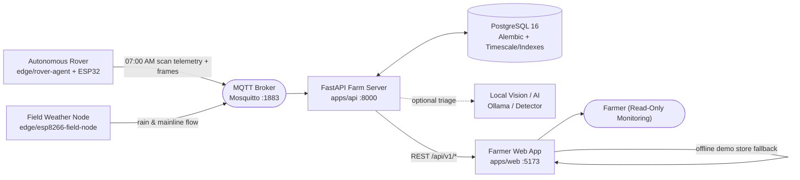

# AgriRover: End-to-End Tomato Platform Workflow

How AgriRover works end to end on `main`: autonomous morning rover monitoring, 3D CAD visualization, live soil telemetry paired with tomato AI vision & 4-step care procedures, per-plant operation cost optimization, and synchronized scheduling across the farm.

> **Frontend Status (`apps/web`):** 100% upgraded to Tomato farming on `main` (`G1–G6`). When running without the live FastAPI backend (`http://localhost:8000`), all pages automatically run from the shared synchronized tomato store (`apps/web/src/lib/roverDemo.ts`, `tomatoFinance.ts`) with a subtle `Sample data · Synced with AgriRover` badge and zero server-error notices.

**Contents:** [What AgriRover Is](#what-agrirover-is) · [Core Value Proposition](#core-value-proposition) · [System Architecture](#system-architecture) · [Farmer UI Workflow (7 Sections)](#farmer-ui-workflow-7-sections) · [Live-Telemetry Care Logic](#live-telemetry-care-logic) · [Per-Plant Unit Economics](#per-plant-unit-economics) · [Safety Hierarchy](#safety-hierarchy) · [Run with Docker](#run-with-docker)

---

## What AgriRover Is

AgriRover is an autonomous greenhouse & field monitoring system built for **tomato farming** across 6 managed blocks (`G1–G6`, 69 active tomato plants across 5 planted beds plus 1 ready bed):

1. **Daily Autonomous Rover Scan (`07:00 AM`):** Traverses each row plant-by-plant (`R1 T1`, `R1 T2`, …), captures canopy/fruit photos, and reads a 7-in-1 soil & ambient probe (`Moisture %`, `Soil pH`, `EC mS/cm`, `Soil Temp °C`, `N·P·K mg/kg`, `Air °C`, `RH %`).
2. **Read-Only Farmer Monitoring:** Farmers never manually start rover hardware rounds or enter soil numbers on `/rover` or `/crop`—AgriRover handles scanning automatically and presents actionable insights in 3D CAD, Plant Vision cards, and step-by-step treatments.
3. **Soil + Vision Fusion & Unit Economics:** Links leaf/fruit detections directly to root-zone telemetry to avoid over-fertilizing or unnecessary spraying, lowering operation cost per tomato plant while preventing crop loss.

---

## Core Value Proposition

| Farmer Problem | What AgriRover Does | Where in App & Code |
|---|---|---|
| Blanket watering wastes water and triggers leaf curl / blossom-end rot | Tracks exact plant moisture against `58%–72%` tomato targets via 3D CAD & precision drip (`~115 L/plant/cycle`, **28% water saved**) | `Rover` (`/rover`), `Plan` (`/plan`), `apps/web/src/lib/soil.ts` |
| Blanket NPK applications burn roots or waste money where soil N is already sufficient | Checks live `Soil N (mg/kg)`, `pH (6.0–6.8)`, and `Moisture` before recommending fertilizer (**22% nutrient savings**) | `PlantSoilModal.tsx`, `apps/web/src/lib/treatments.ts` |
| Early foliar diseases (`Early blight`, `Leaf curl`, `Pest damage`) spread across rows before noticed | Captures automated daily photos with bounding boxes & confidence scores; isolates only affected plants (**35% treatment savings**) | `Health` (`/crop`), `apps/web/src/lib/vision.ts` |
| Unclear profitability per tomato plant or block | Tracks live USD (`$`) + Cambodian Riel (`~៛`) operation cost (`$0.75` vs `$1.02` traditional), net profit, and prevented crop loss | `Finance` (`/finance`, `/cop`, `/harvest`), `tomatoFinance.ts` |
| Weak rural internet breaks cloud dashboards | Designed to run locally on a farm Raspberry Pi / laptop via Docker (`PostgreSQL` + `Mosquitto` + `FastAPI` + `Ollama`), with offline preview fallback in React | `docker-compose.yml`, `apps/web/src/lib/roverDemo.ts` |

---

## System Architecture



### Synchronized Tomato Targets (`G1–G6`)

Every frontend module (`Today`, `Plan`, `Rover`, `Health`, `Crops`, `Finance`, `Farm`) enforces unified tomato targets:

- **Blocks:** `G1 Greenhouse North` (`Roma Tomato`, 15 plants), `G2 Commercial Bed A` (`Cherry Belle`, 10 plants), `G3 Raised Beds B` (`San Marzano`, 10 plants), `G4 Drip Plot C` (`Beefsteak`, 24 plants), `G5 Harvest Bed` (`Roma Tomato`, 10 plants), `G6 Open Field` (`0` plants, ready bed)
- **Soil pH:** `6.0 – 6.8`
- **Soil Moisture:** `58% – 72%`
- **Soil EC:** `0.8 – 2.5 mS/cm`
- **Soil Temperature:** `18 – 29 °C`
- **Nutrients:** `N · P · K` in `mg/kg` (`N < 80 mg/kg` triggers targeted feed; `>= 80 mg/kg` skips heavy soil nitrogen)

---

## Farmer UI Workflow (7 Sections)

| Section | Route(s) | Purpose |
|---|---|---|
| **Today** | `/` | Unified morning summary: rover round count (`5 blocks · 69 plants`), precision drip today (`219 L`, `28% saved`), live vision alerts (`7`), operation cost/plant (`$0.75 / ~3,065 ៛`), `Active Tomato Vision Alerts`, `Today's Top Care Tasks`, and `Active Tomato Blocks`. |
| **Plan** | `/plan` | Connected to live `G1–G6`: automated `07:00 AM` rover schedule, Recharts 7-day precision-drip vs. blanket bar chart (`~1,839 L`, `~28% saved`), N-aware fertigation list (only `G2` at `64 mg/kg`; skips `G1` at `109 mg/kg`), vision-triggered tasks, and Tomato growth stage milestones (`Flowering -> Fruit Set -> Sizing -> Ripening`). |
| **Rover** | `/rover`, `/rover/history` | **100% read-only.** `Today` shows interactive 3D CAD land plots (`SoilCad3D`) + `2D Map` toggle with filter pills (`All plants`, `Needs attention`, `Vision alerts`) synced to the live Soil & AI Vision table. `History` shows soil/air trends and `Past rover checks` (clicking a row opens `RoundSummaryModal`). |
| **Health** | `/crop`, `/guide` | **100% read-only.** Two tabs under *Tomato Vision & Plant Health*: **Rover Vision Gallery** (searchable grid with toggleable AI bounding boxes & click-to-inspect) and **Tomato Disease & Treatment Guide** (`Early blight`, `Leaf curl`, `Yellow leaves`, `Blossom-end rot`, `Pest damage`) with numbered 4-step procedures. |
| **Crops** | `/cycles`, `/cycles/:id/tomato` | Active tomato crop cycle cards (`G1–G6`) with cultivar, plant count, growth stage, live Rover/Health risk tags, and spend vs. budget progress (`$0.75/plant`). |
| **Finance** | `/finance`, `/cop`, `/harvest` | **Per-Plant Cost Optimizer (`Unit Cost & Savings`):** toggles across `1 Tomato Plant`, `Selected Block (G1–G6)`, and `Whole Farm (69 Plants)` in USD + `៛`, plus **Risk Reduction & Crop Loss Prevention** linked directly to live `Health` alerts, `Block Breakdown (G1–G6)`, and `Harvest & Revenue`. |
| **Farm** | `/beds`, `/stock`, `/equipment`, `/devices`, `/settings` | Auto-populated `G1–G6` land & soil texture/depth table with expandable telemetry trends, synchronized `Water & Input Stock` supply ledger, field hardware (`ROVER-TOM-01`, `DRIP-CTRL-A`), equipment depreciation, and economic parameters (`4,085 ៛ / USD`). |

---

## Live-Telemetry Care Logic (Mulder's Chart & Fast-Focus Cards)

When a farmer inspects a tomato plant in **`Rover`**, **`Health`**, **`Today`**, or **`Plan`**, `evaluateAgronomyAction(plant, targets)` ([agronomyEngine.ts](../apps/web/src/utils/agronomyEngine.ts)) cross-checks live `N, P, K, pH, EC, Moisture, Soil Temp` against AI vision findings using **Mulder's Chart Nutrient Antagonism**:

1. **Dynamic Mulder Antagonism Rules:**
   - **Low `K` (`< 160 mg/kg`):** Recommends Potassium Sulfate (`K2SO4`) or `KNO3` (if N < 80); warns **not** to apply high Calcium (`Ca`) or Magnesium (`Mg`) simultaneously.
   - **High `K` (`> 230 mg/kg`, e.g., `G4` at `235 mg/kg`):** Warns that excess `K` blocks **`Ca` & `Mg`** uptake (blossom-end rot / chlorosis risk); advises skipping extra `K` / heavy `N`.
   - **High `P` (`> 85 mg/kg`, e.g., `G3` average `90 mg/kg`, `R2 T4` at `89 mg/kg`):** Warns that excess `P` blocks **`Zn`, `Fe`, and `Ca`** uptake; blocks DAP / MAP / P-boosters.
   - **Optimal/High `N` (`>= 105 mg/kg`, e.g., `G1 R2 T2` at `109 mg/kg`):** Identifies lower-canopy aging rather than N shortage and warns **not to add Urea/high-N** (excess `N` blocks `K` and weakens fruit).
   - **Tank-Mix Safety:** Always warns **never to mix Calcium (`Ca`) with Sulfates or Phosphates** in the same concentrated tank.
2. **Compact 4-Block Fast-Focus Format (`FastFocusCard.tsx`):**
   - **⚡ `DO THIS NOW`:** Concise 1–2 line dose & field action.
   - **🚫 `DO NOT MIX / AVOID`:** Explicit Mulder antagonism & tank-mix warning.
   - **🎯 `EXPECTED RESULT`:** Measurable recovery window & input savings.
   - **🔬 `WHY`:** 1-line live soil sensor trigger summary.
3. **Interactive `MulderQuickCheck` in `Health` (`/crop` & `/guide`):** Lets farmers pick **`Low K`**, **`High K`**, **`High N`**, **`High P`**, **`Low Ca`**, **`Low Mg`**, or any live block (`G1–G6`) to inspect Synergy, Antagonism, and Tank-Mix rules.

---

## Per-Plant Unit Economics

Benchmarks implemented in `apps/web/src/lib/tomatoFinance.ts` (`4,085 ៛ / USD`):

| Cost Input | AgriRover Precision | Traditional Farming | Savings | Reduction |
|---|---|---|---|---|
| Water (Precision Drip via Rover · `~115 L/cycle`) | `$0.06` (`~245 ៛`) | `$0.083` (`~340 ៛`) | `$0.023` (`~95 ៛`) | **28% saved** |
| Nutrients & Soil Amendments (`NPK + Calcium`) | `$0.18` (`~735 ៛`) | `$0.23` (`~940 ៛`) | `$0.05` (`~205 ៛`) | **22% saved** |
| Targeted Disease & Pest Treatment | `$0.09` (`~370 ៛`) | `$0.14` (`~570 ៛`) | `$0.05` (`~200 ៛`) | **35% saved** |
| Seedling, Substrate & Labor | `$0.42` (`~1,715 ៛`) | `$0.567` (`~2,315 ៛`) | `$0.147` (`~600 ៛`) | **26% saved** |
| **Total per Tomato Plant** | **`$0.75` (`~3,065 ៛`)** | **`$1.02` (`~4,165 ៛`)** | **`$0.27` (`~1,100 ៛`)** | **26% saved** |

- **Expected Yield & Margin per Plant:** `~4.5 kg` yield × `$0.80/kg` = **`$3.60` (`~14,700 ៛`) revenue** → **`$2.85` (`~11,635 ៛`) net profit** (`79% margin`).
- **Crop Loss Prevention:** Each caught alert preserves `~1` fruiting plant (`$3.60 / ~14,700 ៛` → `7` active alerts = **`$25.20` / `~102,900 ៛`** prevented, synced identically across `Today` and `Finance`).

---

## Safety Hierarchy

A lower hardware/firmware layer can always override or halt higher-level commands ([control-hierarchy.md](architecture/control-hierarchy.md)):

| Layer | Guarantee | Code |
|---|---|---|
| Motor-controller firmware | Max wheel burst `1.5 s` at PWM <= `200`; stops on `2 s` lost serial or bumper switch | `edge/rover-motor-controller` |
| Rover edge agent | Max speed `0.3 m/s`, <= `1 m` step; checks e-stop, rain, battery `< 11.1 V`, link | `edge/rover-agent` |
| Field node firmware | Relay hardware timeout `MAX_RUN_MS` | `edge/esp8266-field-node` |
| Server rule engine | Checks rain, daylight window, cooldown, moisture threshold | `apps/api/app/services/rule_engine.py` |
| Human farmer | All dashboard screens are read-only advisories; farmers verify treatments & water schedules | `apps/web` |

---

## Run with Docker

See the complete backend setup, database schema, Alembic migrations, and API contract checklist in [BACKEND-DOCKER-GUIDE.md](BACKEND-DOCKER-GUIDE.md) and [SCHEMA.md](SCHEMA.md).

```powershell
# 1. Configure environment variables
Copy-Item .env.example .env

# 2. Start PostgreSQL 16 + Mosquitto MQTT + FastAPI + React Web (and optional rover simulator)
docker compose --profile sim up -d
```

| URL | Service |
|---|---|
| `http://localhost:5173` | AgriRover Farmer Web App (`apps/web`) |
| `http://localhost:8000/docs` | FastAPI OpenAPI / Swagger UI (`apps/api`) |
| `http://localhost:8000/health` | API Healthcheck |
