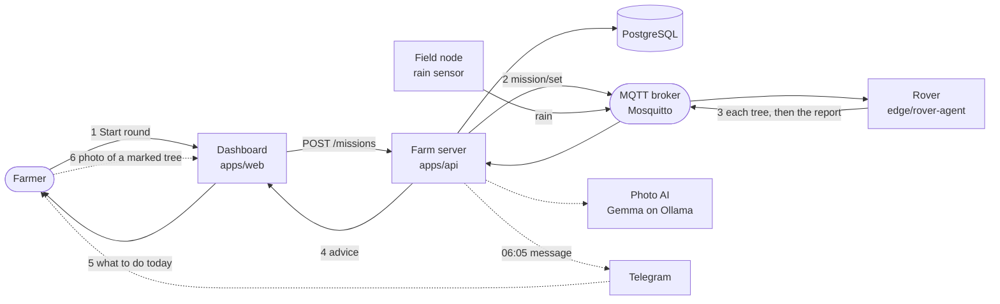

# AgriRover: end-to-end workflow

How AgriRover works from start to finish: what the rover does, what the farm server does with it, what the farmer sees and does, and where each step lives in the code. Start here; the other docs go deeper.

> **The software is real; the rover hardware is not built.** The wheels, camera, soil probe and orchard are simulated, and every simulated report says `simulated: true`. The rover never waters or feeds: a person always acts.

Checked against the code on 2026-11-27 (commit `2a2889d`).

**Contents:** [What it is](#what-agrirover-is) · [Problems it solves](#the-problems-it-solves) · [At a glance](#the-workflow-at-a-glance) · [Step by step](#step-by-step-one-day) · [Other flows](#other-flows) · [Safety](#safety-who-can-stop-what) · [AI prompts](#the-ai-prompts) · [Run it](#run-it-on-your-computer) · [Where to change things](#where-to-change-things) · [Real or simulated](#what-is-real-and-what-is-not)

## What AgriRover is

AgriRover is a field rover and a farm server for one crop: **guava**. A person starts a round on the Rover screen, and the rover goes to every tree in a block. At each tree it photographs the canopy and reads the soil and the air. The farm server turns the round into one list for the day: how many litres each tree gets, whether to feed, and which trees to go and look at. Everything runs on the farm (a Raspberry Pi, a local MQTT broker, a local AI model), so it keeps working when the internet drops.

**Where it is going:** since 6 Nov 2026 the goal is a rover that checks guava **leaf nutrients**, block by block: collect a leaf, scan it, act (the concept of Picketa's LENS, see [PLAN.md](PLAN.md)). That nutrient round is **not built**. What exists today is the daily soil round (in simulation), the photo check, and a place to record lab leaf results.

## The problems it solves

| The farmer's problem | What AgriRover does | Where |
|---|---|---|
| Checking trees means walking every row, so problems are seen late | The rover visits every tree and marks the ones with yellow leaves or a small canopy. Plant health shows them on a 3D map of the farm | `edge/rover-agent/rover/vision.py`, Health |
| Water is given by the block, on a habit | Litres for each tree, from its own soil moisture, the crop stage and the weather. A tree whose soil is in the upper half of its target gets nothing today | `apps/api/app/services/advisor.py` |
| Too much fertiliser burns a tree; too little lowers the grade | Feed follows the stage plan, little and often (every 10 days). Soil EC above target holds the feed; above 3.0 it asks for a flush. Lab leaf results are recorded, to correct the plan later | `advisor.advise_feed`, Health › Leaf tests |
| A sick-looking leaf could be a disease or a feed shortage | A phone photo is checked by AI and read beside that tree's own soil readings, for example "feed or soil, not a disease" | `services/disease.py`, `services/tree_check.py` |
| Rural internet is weak, and cloud tools stop when it drops | Everything runs on the farm. Only optional extras, such as the Telegram message and the hosted photo model, need the internet | `docker-compose.yml` |
| Not knowing where the money goes | Costs, harvest, sales and cost per kg, block by block | Finance |

None of this is measured in a field yet. The steps to prove it are in [PLAN.md](PLAN.md#step-4-accelerate-weekly-cycles).

## The workflow at a glance



In words:

1. A person ticks the checks and presses **Start round** on the Rover screen.
2. The farm server sends the round to the rover over MQTT.
3. The rover drives from tree to tree. At each one it takes a photo, reads the soil probe and the air sensor, and reports.
4. The farm server stores the round and works out the day's advice.
5. **Today** shows the farmer what to do: water, feed, trees to look at.
6. The farmer acts, and photographs a marked tree for a closer look.

## Step by step: one day

| # | Step | What happens | Code |
|---|---|---|---|
| 0 | Set up the farm (once) | Blocks, tree count, spacing, variety, planting date and growing setup. The first start seeds a demo farm: six blocks (G1 to G5 growing guava, G6 empty) and two weeks of simulated rounds | `apps/api/app/services/seed.py`; screens Farm › Beds & Land, Crops |
| 1 | Get ready | On **Rover**, pick the block. Start stays locked until three live checks pass (rover online, e-stop released, no rain) and a person ticks three more (rows clear, rover at the first tree facing along row 1, camera and probe clean) | `apps/web/src/pages/Rover.tsx`, [ROVER-SOP.md](ROVER-SOP.md) |
| 2 | Send the round | `POST /api/v1/missions {zoneId, rows, cols, cellM, rowM}`. Refused if the rover is busy, offline or e-stopped. Published to MQTT `devices/rover-01/mission/set` | `apps/api/app/routers/missions.py` |
| 3 | Plan the path | The rover checks the round (at most 400 trees, 40 a side, spacing 0.2 to 10 m) and plans a serpentine path: every tree once, in moves of at most 1 m | `edge/rover-agent/rover/planner.py`, `mission.py` |
| 4 | At each tree | Check the guards (e-stop, rain, battery below 11.1 V, lost link) → drive → photograph → leaf cover and yellowing from colour (over 8 % yellow is flagged) → soil probe and air sensor → record | `rover/safety.py`, `drive.py`, `vision.py`, `probe.py` |
| 5 | Live progress | Each tree goes out on `mission/state`. The server keeps the live round in memory, and the Rover screen reads it from `GET /api/v1/missions/live` | `apps/api/app/services/rover_live.py` |
| 6 | Store the round | The full report goes out on `mission/result`. The server stores it in `survey_mission` and `survey_finding` (one row per tree), and the block's averages in `sensor_reading`. The rover also writes `reports/<mission>/report.json` and `field-map.svg` on its own disk | `apps/api/app/workers/mqtt_ingest.py`, `rover_live.store_report` |
| 7 | Work out the advice | For each growing block, the newest round from the last 36 hours becomes: litres per tree, feed / hold / flush, and trees to look at. Pure functions with tests; nothing here opens a valve | `services/advice.py` (reads the database), `services/advisor.py` (the rules); `GET /api/v1/advice` |
| 8 | Show it | **Today** reads left to right: **Read** (trees read, blocks done today) → **Find** (problems, each with its number against the target) → **Act** (litres of water, blocks to feed). Below it, one list of jobs, most urgent first | `apps/web/src/pages/Dashboard.tsx`, `lib/today.ts`, `lib/problems.ts` |
| 9 | The farmer acts | Gives the water, feeds only where Today says feed, and goes to each marked tree. **Done** ticks a job off, and can be undone | Today |
| 10 | Look closer | **Health**: click a marked tree in the 3D farm, add a photo, **Check photo**. The answer card gives the problem, the likely cause from that tree's soil, and what to do. **Save** keeps the photo with the tree's readings | `pages/Crop.tsx`, `POST /api/v1/photos/check`, `services/tree_check.py` |
| 11 | Confirm photos | An expert confirms saved photos in Health › Photo library. Only confirmed photos may train or test a model | [PHOTO-LABELLING.md](PHOTO-LABELLING.md) |
| 12 | Leaf test (once a cycle) | At flowering (the task falls on day 86 to 94), pick leaves the standard way, send them to a lab, and enter the results under Health › Leaf tests. Each figure is rated low / OK / high, and Blocks compared puts the blocks side by side. Advice does not read them yet | `pages/LeafTests.tsx`, `services/leaf_tests.py`, [leaf sample how-to](ROVER-SOP.md#leaf-sample-how-to) |

**When a round stops early** (e-stop, rain, low battery, lost link, edge of block, bumper), the rover ends stopped and sends a partial report. Today then says how many trees were not reached, and does not call the block fine. A round cannot resume: run the block again from the first tree. What to do for each reason: [ROVER-SOP.md](ROVER-SOP.md#when-it-stops).

## Other flows

**Rain and the field node.** The fixed field node (ESP8266) reports rain, water pH, soil moisture and supply voltage on `farm/<farm>/zone/<zone>/telemetry`, and the server stores it in `sensor_reading`. Rain stops a round, and Today's water falls to nothing. In the demo the `field-sim` service stands in for the node: `SIM_SCENARIO=rain` in `.env` makes it rain. Code: `edge/esp8266-field-node`, `edge/field-node-sim`.

**Daily Telegram message.** When `TELEGRAM_BOT_TOKEN` and `TELEGRAM_CHAT_ID` are set, the server sends a message at 06:05 farm time (`DAILY_MESSAGE_TIME`) with each block's water decision and **Approve / Skip** buttons. Approving records who said yes; it does not open a valve. It still uses the older rule engine (`services/decisions.py`, `services/rule_engine.py`), not the rover's advice. Code: `apps/api/app/workers/telegram_worker.py`, `services/daily_message.py`.

**Plan, Crops and Finance.**
- **Plan:** water, feed, tasks and stage changes by date, for every block (`GET /api/v1/schedule`, `services/schedule.py`).
- **Crops:** each block's cycle: crop day, stage, tasks with Done, fruit size (`/cycles/:id/orchard`, `services/guava.py`).
- **Finance:** costs, harvest and sales, cost of production per kg, blocks compared (`services/cost.py`, `services/cop_report.py`). The Overview shows sample figures.

## Safety: who can stop what

A lower layer can always stop a higher one, never the reverse ([control-hierarchy.md](architecture/control-hierarchy.md)).

| Layer | Guarantee | Code |
|---|---|---|
| Motor-controller firmware | Every wheel run lasts at most 1.5 s at PWM 200 or less. Stops on a lost serial link (2 s) and on the bumper | `edge/rover-motor-controller` |
| Rover software | Speed at most 0.3 m/s, steps at most 1 m. Guards before every move and photo: e-stop, rain, battery, link | `rover/safety.py`, `drive.py`, `mission.py` |
| Field-node firmware | Every relay closes at `MAX_RUN_MS`, whatever the server says | `edge/esp8266-field-node` |
| Rule engine | Rain, daylight, soil moisture and cooldown are checked before any water | `apps/api/app/services/rule_engine.py` |
| A person | The rover and the app only advise. A person waters and feeds | |

**Not done yet, and needed before any physical run:** a physical power-cut switch (the on-screen e-stop travels over Wi-Fi), a login (anyone with the app's address can start the rover), navigation between trunks, and the soil-probe reader. Details: [rover.md](architecture/rover.md#known-limits--and-what-comes-next).

## The AI prompts

The app sends prompts to an AI model in one place today: the photo check. The prompts live in the code, so changing one is a code change, scored before it is kept.

| Prompt | File | Used |
|---|---|---|
| `SCREEN_PROMPT`: is this leaf or fruit healthy, a problem, or unsure? | `apps/api/app/services/disease.py` | Every photo check |
| `MATCH_PROMPT`: the guava disease guide, then the two closest entries | `disease.py`; the guide is in `services/guava_diseases.py` | Only with `PHOTO_MATCHES=true` (off by default) |
| `SYSTEM_PROMPT`: a farm assistant that may read data and only *propose* an action | `apps/api/app/services/assistant.py` | Not wired: `POST /api/v1/assistant/chat` answers 501. Its text still describes the old vegetable bed |

### How a photo check runs

1. The photo (JPEG or PNG, at most 8 MB) goes to `POST /api/v1/photos/check`, with the block, row and tree when it comes from a marked tree.
2. **Screen.** The model gets `SCREEN_PROMPT` and the photo at temperature 0, and must answer JSON that fits a schema: `{"seen": "...", "label": "healthy" | "problem" | "unsure"}`. It is told not to name a disease.
3. Unsure, or a word outside the list, counts as no answer: the farmer is asked for a clearer, closer photo.
4. **Match** (only with `PHOTO_MATCHES=true`). `MATCH_PROMPT` carries the whole disease guide (13 entries) and asks for `{"where", "label", "also"}`. `where` comes first, so the model looks at which leaves carry the signs before it names anything: young growth points to rust, old leaves to a feed shortage.
5. The answer is shown with that tree's soil readings (`services/tree_check.py`) and the note "Triage only, not a diagnosis".
6. `confidence` stays empty, because a language model's own "90 % sure" is not a measured probability. Only a trained model with measured accuracy may run the soil check by itself.

Photos go only to the Ollama server named in `.env`:

| Setting | Default | Meaning |
|---|---|---|
| `OLLAMA_URL` | `http://host.docker.internal:11434` | Ollama on this machine: photos stay on the farm |
| `OLLAMA_MODEL` | `gemma4` | Empty turns the photo check off |
| `OLLAMA_API_KEY` | empty | Only for the hosted service at `https://ollama.com`. Photos then leave the farm |
| `PHOTO_MATCHES` | `false` | Suggest disease names from the guide |

**How good it is** ([measured](GUAVA-RESEARCH.md#photo-check-what-was-measured-2026-11-05) on public photos, not ours): telling healthy from a problem, local `gemma4` got 130 of 148 right. Naming the problem, hosted `gemma4:31b` got 61 of 120 (optimistic, because the prompt was chosen on those photos) and local `gemma4` got 18 of 119, which is why names are off by default. The app tells the farmer "about 4 in 10".

### Changing a prompt

1. Edit the prompt in `disease.py`, or an entry in `guava_diseases.py` (the Disease guide screen shows the same text).
2. Score it on a folder of labelled photos, one sub-folder per class, from the repository root. The script uses the app's own prompt and needs the farm server's Python packages (`pip install -r apps/api/requirements.txt`). Add `--matches` to score the match step too:

   ```powershell
   python scripts/eval_photo_check.py photos --map "healthy_leaf=healthy,red_rust_leaf=problem" --out results.json
   ```

3. Keep the change only if it beats the last score in [GUAVA-RESEARCH.md](GUAVA-RESEARCH.md#photo-check-what-was-measured-2026-11-05), and add its row there.
4. A disease name never triggers advice on its own ([PHOTO-LABELLING.md](PHOTO-LABELLING.md#when-a-model-may-name-a-disease)).

## Run it on your computer

You need **Docker Desktop**. Python and Node are only needed to run a part outside Docker. The photo check needs **Ollama** with a vision model.

1. Check what is installed:

   ```powershell
   powershell -ExecutionPolicy Bypass -File scripts\preflight.ps1
   ```

2. Make your settings file, then set the passwords in `.env` (on macOS or Linux: `cp .env.example .env`):

   ```powershell
   Copy-Item .env.example .env
   ```

3. For the photo check, get the model:

   ```powershell
   ollama pull gemma4
   ```

4. Start everything: database, MQTT broker, farm server, dashboard, a simulated rover and a simulated field node. Leave out `--profile sim` for the server and dashboard alone.

   ```powershell
   docker compose --profile sim up -d
   ```

| Open | For |
|---|---|
| http://localhost:5173 | The app |
| http://localhost:8000/docs | Every API endpoint, to try in the browser |

**Walk the workflow in five minutes:**

1. **Rover:** pick a block chip, tick the three checks, **Start round**. It goes tree by tree, forty times faster than a real rover (about 30 s).
2. **Today:** Read → Find → Act. Open a problem to see its number against the target.
3. **Health:** click a tree marked **!** in the 3D farm, add a leaf photo, **Check photo**, then **Save**.
4. **Health › Leaf tests:** where lab results go. Leave it empty until a real one comes; never type in made-up figures.
5. **Finance:** where the money goes (sample figures).

The full demo, with what to say: [DEMO-SCRIPT.md](DEMO-SCRIPT.md).

| To | Run |
|---|---|
| Watch the server | `docker compose logs -f api` |
| Watch the rover | `docker compose logs -f rover-sim` |
| Make it rain | Set `SIM_SCENARIO=rain` in `.env`, then `docker compose --profile sim up -d` again |
| Stop everything | `docker compose --profile sim down` |
| Run the rover alone, without Docker | In `edge/rover-agent`: `pip install -r requirements.txt`, then `python -m rover sim`. Add `--battery 11.3` to watch the low-battery guard stop it |

**Tests.** CI runs all four on every push (`.github/workflows/ci.yml`).

| Part | Folder | Commands |
|---|---|---|
| Farm server | `apps/api` | `pip install -r requirements.txt`, then `python -m pytest`. Database tests skip unless the compose `db` is running |
| Rover | `edge/rover-agent` | `pip install -r requirements.txt`, then `python -m pytest` |
| Dashboard | `apps/web` | `npm ci`, then `npm test` |
| Motor firmware | `edge/rover-motor-controller/test` | `g++ -std=c++11 -I.. test_drive_protocol.cpp -o t`, then `./t` |

## Where to change things

| To change | Edit | Tests |
|---|---|---|
| Water per tree, feed, trees to look at | `apps/api/app/services/advisor.py` | `apps/api/tests/test_advisor.py` |
| Guava stages, targets, tasks, leaf ranges | `apps/api/app/services/guava.py` | `test_advisor.py`, `test_schedule.py`, `test_leaf_tests.py` |
| When water may run (valve rules) | `apps/api/app/services/rule_engine.py` | `test_rule_engine.py` |
| How the rover plans, drives, guards and sees | `edge/rover-agent/rover/` | `edge/rover-agent/tests/` |
| Sending rounds, live state, storing reports | `routers/missions.py`, `services/rover_live.py`, `workers/mqtt_ingest.py` | `test_missions_and_ingest.py`, `test_rover_live.py` |
| Photo AI prompts and the disease guide | `services/disease.py`, `services/guava_diseases.py` | `scripts/eval_photo_check.py` |
| Screens | `apps/web/src/pages/`, with their logic in `apps/web/src/lib/` | `apps/web/src/lib/*.test.ts` |
| Database tables | `apps/api/app/models/entities.py`, plus a new migration in `apps/api/alembic/versions/` | `test_migrations.py`; design in [SCHEMA.md](SCHEMA.md) |

## What is real and what is not

| Part | Today |
|---|---|
| Rover software: path, guards, vision, MQTT, reports | **Real code**, on simulated wheels, camera, probe and orchard |
| Rover hardware: chassis, GNSS and LiDAR, mast camera, probe arm | Not built |
| Soil probe reader (7-in-1, RS485) | Not written: it needs the probe's datasheet |
| Advice: water, feed, trees to look at | Built and tested. Starting rules, no field results |
| Photo check | Works. Triage only, never a diagnosis |
| Leaf nutrient scan on the rover | Not built. Lab results can be recorded and rated |
| Telegram daily message | Built. Uses the older rule engine |
| AI assistant chat | Not wired |
| Login | None yet |

Status per part, with paths: [README](../README.md#status). What comes next: [PLAN.md](PLAN.md#next-in-the-repo).

## Further reading

| Doc | For |
|---|---|
| [PLAN.md](PLAN.md) | What we sell, the plan and the risks |
| [architecture/rover.md](architecture/rover.md) | The rover's design, MQTT topics, parts and limits |
| [architecture/control-hierarchy.md](architecture/control-hierarchy.md) | Who decides when water runs |
| [ROVER-SOP.md](ROVER-SOP.md) | Running a round, and taking leaf samples |
| [DEMO-SCRIPT.md](DEMO-SCRIPT.md) | The five-minute demo |
| [GUAVA-RESEARCH.md](GUAVA-RESEARCH.md) | The evidence behind the numbers |
| [SCHEMA.md](SCHEMA.md) | The database |
| [UX-DECISIONS.md](UX-DECISIONS.md) | Why the screens look the way they do |
