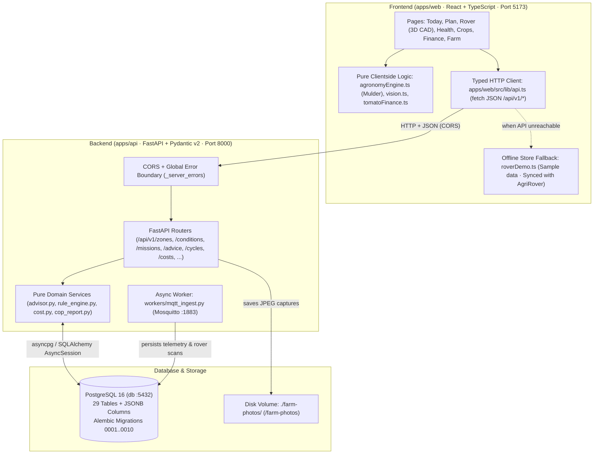
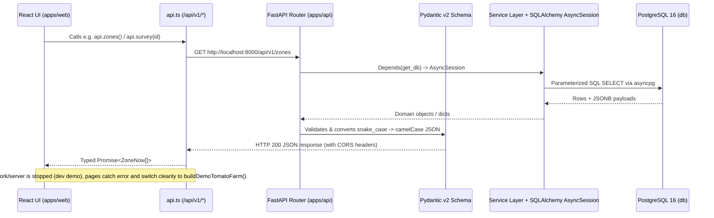

# AgriRover Frontend ↔ Backend ↔ Database Architecture Standard

How the React UI (`apps/web`), FastAPI server (`apps/api`), MQTT workers, and PostgreSQL 16 database (`postgres:16-alpine`) communicate, validate contracts, and persist data cleanly.

---

## 1. Which Database Do We Use? (PostgreSQL 16 + JSONB — Not MongoDB)

AgriRover uses **PostgreSQL 16** (`postgres:16-alpine` in `docker-compose.yml`) accessed asynchronously via **`SQLAlchemy 2`** + **`asyncpg`** and versioned with **`Alembic`** (`apps/api/alembic/versions/0001`–`0010`), configured in [`apps/api/app/core/db.py`](../../apps/api/app/core/db.py).

We do **not** use MongoDB. Instead, AgriRover uses a **Relational + `JSONB` Hybrid Model** inside PostgreSQL:

| Aspect | Our Current Stack (`PostgreSQL 16 + JSONB`) | Why Not Switch to MongoDB |
|---|---|---|
| **Flexible sensor / AI fields** | Uses native **`JSONB`** columns (`survey_finding.readings`, `plant_photo.readings`, and planned `vision_boxes` / `steps`) — stores arbitrary JSON objects cleanly with zero rigid columns. | Switching to MongoDB is unnecessary just for JSON flexibility because Postgres `JSONB` handles nested arrays/objects while staying in one DB engine. |
| **Financial & crop-cycle integrity** | Enforces strict foreign keys & SQL `CHECK` constraints across `cost_entry`, `sale`, `harvest`, `stock_move`, `daily_decision`, and `action_proposal` (e.g., `CHECK (status <> 'approved' OR approved_by IS NOT NULL)`). | MongoDB lacks out-of-the-box multi-table foreign keys and database-level check constraints needed for accounting & safety attribution. |
| **Time-series & latest-reading speed** | Uses the composite B-tree index `ix_sensor_reading_zone_metric_time` on `(zone_id, metric, recorded_at)` so per-bed telemetry lookups run in `< 20 ms`. | Replaces all existing backend code: `apps/api` uses SQLAlchemy 2 + Alembic (`test_migrations.py`, `test_schema.py`), which would all require a full rewrite for MongoDB/Beanie. |
| **Raspberry Pi footprint** | Single lightweight container (`postgres:16-alpine`) runs telemetry, AI photo metadata, schedules, and ERP ledger together offline. | Keeps edge deployment lean and backs up via a single `pg_dump` + `./farm-photos/` archive. |

---

## 2. Three-Tier Communication Architecture

---

## 3. End-to-End Request Lifecycle

### Standard Conventions Enforced Across Layers

1. **API Versioning & Base URL:**
   - Every backend route mounts under `/api/v1` in [`apps/api/app/main.py`](../../apps/api/app/main.py).
   - Frontend reads `VITE_API_BASE` (`http://localhost:8000/api/v1` default) inside [`apps/web/src/lib/api.ts`](../../apps/web/src/lib/api.ts).
2. **Naming Translation (`snake_case` DB ↔ `camelCase` JSON):**
   - PostgreSQL columns & Python domain code use `snake_case` (`plant_count`, `area_m2`, `soil_ph`).
   - FastAPI Pydantic schemas use `ConfigDict(alias_generator=to_camel, populate_by_name=True)` (see `BedIn` in `apps/api/app/routers/zones.py`) so JSON payloads use idiomatic TypeScript `camelCase` (`plantCount`, `areaM2`).
3. **Swagger / OpenAPI Contract Sync:**
   - FastAPI auto-generates `http://localhost:8000/docs` (Swagger UI), `http://localhost:8000/redoc`, and `http://localhost:8000/openapi.json`.
   - When modifying or adding endpoints, always annotate request and `response_model=` schemas in Pydantic so `/openapi.json` remains accurate and optionally consumable by `openapi-typescript`.
4. **Error Handling + CORS:**
   - Domain exceptions (`NotFound` -> `404`, `Conflict` -> `409`, `Invalid` -> `422`) and unhandled `500` errors return clean JSON (`{"detail": "..."}`) inside the CORS middleware wrapper so the browser never mistakes a 500 error for a network failure.
5. **Client-Side Agronomy & Offline Continuity:**
   - Fast visual intelligence (**Mulder's Chart Quick Check**, **Action → Avoid → Result → Why** care evaluation in `apps/web/src/utils/agronomyEngine.ts`, and `tomatoFinance.ts` unit economics) runs cleanly in pure TypeScript on top of live telemetry objects—so UI reactivity is instant whether telemetry comes from live PostgreSQL via FastAPI or the synchronized demo store.

---

## 4. Standard Checklist: Adding a New Feature End-to-End

Whenever adding a new table, sensor field, or frontend feature, follow this 4-step standard:

1. **Database Layer (`apps/api/app/models/entities.py` + Alembic):**
   - Add column(s) or `JSONB` field in `entities.py`.
   - Generate migration (`docker compose exec api alembic revision --autogenerate -m "..."`) and verify `tests/test_migrations.py` (`compare_metadata == []`).
2. **Service & Validation Layer (`apps/api/app/services/`):**
   - Put pure calculation / business rules in pure testable modules (e.g., `rule_engine.py`, `metrics.py`, `advisor.py`) before wiring database queries.
3. **API Router & Pydantic Schema (`apps/api/app/routers/`):**
   - Define `BaseModel` schemas with `to_camel` alias generation and explicit `response_model`, register router under `V1 = "/api/v1"` in `main.py`, and verify at `http://localhost:8000/docs`.
4. **Frontend Integration (`apps/web/src/lib/api.ts` + Components/Tests):**
   - Add TypeScript types and request wrappers to `api.ts`, provide clean offline fallback if appropriate in `roverDemo.ts`, add Vitest coverage in `*.test.ts`, and run `npm test && npm run build`.

---

## Related Docs

- [`docs/SCHEMA.md`](../SCHEMA.md) — Exact PostgreSQL tables (`0001–0010`) and Migration `0011` Tomato spec.
- [`docs/BACKEND-DOCKER-GUIDE.md`](../BACKEND-DOCKER-GUIDE.md) — Docker Compose commands, `.env` variables, `psql` operations, and `/api/v1/*` endpoint contract checklist.
- [`docs/WORKFLOW.md`](../WORKFLOW.md) — End-to-end Tomato farmer workflow, Mulder rules, and unit economics.
