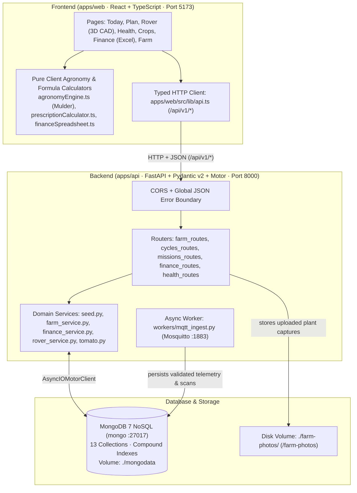
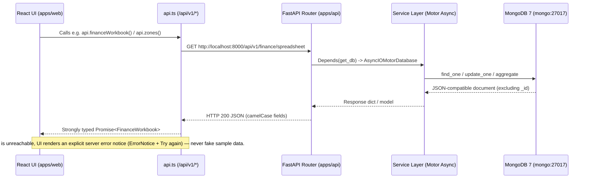

# AgriRover Frontend ↔ Backend ↔ Database Architecture Standard

How the React UI (`apps/web`), FastAPI server (`apps/api`), Mosquitto MQTT worker, and **MongoDB 7 NoSQL database** (`mongo:7` in Docker) communicate, validate contracts, and persist real farm data end-to-end with zero frontend mock fallbacks.

---

## 1. Database Choice: MongoDB 7 (NoSQL) via Motor

AgriRover stores all operational documents, nested rover scan grids, hourly telemetry series, financial ledgers, and customizable Excel workbooks in **MongoDB 7** (`mongo:7`), accessed asynchronously from Python via **`motor` (`AsyncIOMotorClient`)** in [`apps/api/app/core/db.py`](../../apps/api/app/core/db.py).

| Why MongoDB (NoSQL) Fits AgriRover | How We Implement It Cleanly |
|---|---|
| **Natural fit for nested rover grids & telemetry** | Each scan in `surveys` embeds its full plant grid (`cells[]`, per-plant `readings`, vision fields) directly — one query returns a whole bed map with zero multi-table joins. |
| **Schema agility for interactive UI tools** | Features like the `/finance` Excel Calculator store editable assumptions + dynamic line-item rows directly in `finance_workbooks` without brittle schema migrations. |
| **Fast time-series & bed lookups** | Compound indexes in `ensure_indexes()` (`(farmName, zone, metric, ts)`, `(farmName, zone, startedAt)`, `(farmName, zone, status)`) keep per-bed telemetry and round queries fast. |
| **Zero-config startup in Docker & tests** | `seed_farm(db)` ensures indexes and seeds Tomato `G1–G6` idempotently on API startup; `tests/conftest.py` tests against live `mongo:7` in CI (`MONGODB_URL`) or `mongomock-motor` in isolated local runs. |

---

## 2. Three-Tier Communication Architecture

---

## 3. End-to-End Request Lifecycle

### Standard Conventions Across Layers

1. **Zero Offline Mock Data:** Production UI modules never import offline demo builders; `ErrorNotice` + `errorText(error)` report API errors with a retry, while test fixtures live strictly under `apps/web/src/test/fixtures.ts`. The backend does not invent data either: a new bed has no readings until a sensor reports, the rover is `unknown` until it speaks, and the photo check says when no model is installed.
2. **Versioned API Contract (`/api/v1`):** All routes mount under `/api/v1` in [`apps/api/app/main.py`](../../apps/api/app/main.py), and `apps/web/src/lib/api.ts` reads `VITE_API_BASE` (`http://localhost:8000/api/v1` default).
3. **`camelCase` JSON Boundary:** MongoDB documents store TypeScript-aligned `camelCase` keys directly (`plantCount`, `areaM2`, `sellingPricePerKg`), and FastAPI request schemas (`_Camel`) accept both `camelCase` and `snake_case` via `ConfigDict(alias_generator=to_camel, populate_by_name=True)`.
4. **Auto-Generated OpenAPI Docs:** FastAPI serves live interactive docs at `http://localhost:8000/docs`, `http://localhost:8000/redoc`, and `http://localhost:8000/openapi.json`.
5. **Client-Side Agronomy & Financial Formulas:** Live soil readings fetched from MongoDB feed `agronomyEngine.ts` (**Mulder's Chart** antagonism rules), `prescriptionCalculator.ts` (exact nutrient/water/foliar dosing formulas), and `financeSpreadsheet.ts` (interactive Excel formulas synced back to `/api/v1/finance/spreadsheet`).

---

## 4. Standard Checklist: Adding a New Feature End-to-End

1. **MongoDB Indexes & Seed (`apps/api/app/core/db.py` & `services/seed.py`):**
   - Add any new collection indexes inside `ensure_indexes(db)` and initial seed documents inside `seed_farm(db)` cleanly and idempotently.
2. **Service & Validation Logic (`apps/api/app/services/`):**
   - Keep pure calculations & validation rules modular (`tomato.py`, `metrics.py`, `finance_service.py`, `farm_service.py`).
3. **FastAPI Router (`apps/api/app/routers/`):**
   - Add Pydantic input models using `_Camel` + FastAPI route handlers under `/api/v1/*`; strip internal Mongo `_id` in projections (`{"_id": 0}`).
4. **Tests & Frontend Wiring (`apps/api/tests/` + `apps/web/src/lib/api.ts` + `apps/web/src/lib/queries.ts`):**
   - Add integration coverage (`test_api_mongodb.py`, `test_integration_flows.py`), wire the typed call in `api.ts`, then add a
     read hook or a write hook in `queries.ts` that names what it changes (`invalidates`). Pages use the hook, never `api.*` directly.
   - Verify with `pytest -v`, `npm test`, and `npm run build`.

---

## 5. Shared Data on the Frontend (`apps/web/src/lib/queries.ts`)

Every page reads the farm through one cache (TanStack Query), so the same record is fetched once and shown the same everywhere.

| Piece | What it does |
|---|---|
| `qk` | One key per record type (`zones`, `cycles`, `conditions`, `advice`, `surveys`, `survey(id)`, `workbook`, `costs`, `cop(id)`, …) |
| `useZones()`, `useCycles()`, … | Read hooks. Live data refreshes itself: conditions and advice every minute, the status bar every 10 s, the rover every 1.5 s during a round |
| `useFarm()` | The overview most pages share: beds, crops, conditions, advice, newest round per bed, the Finance workbook and spending per crop, combined into block economics once |
| `useAddHarvest()`, `useStockUse()`, … | Write hooks. Each declares what it changes, e.g. a harvest refreshes harvests, cost reports and comparisons; stock use refreshes stock, the cost ledger and cost reports |
| `noteRoundState()` | When a rover round ends, everything built from rounds (conditions, advice, plan, history, devices) is fetched again, and a toast says so |
| `farmContext.tsx` | The block (and plant) you are looking at, shared by Today, Rover, Health, Plan, Harvest and the ledger |
| `toast.ts` | App-wide notices for saves and failures |

## 6. Where Each Number Comes From

| Number | Source |
|---|---|
| Budget per plant (Today, Crops, By block, cost reports) | The Finance workbook saved in `finance_workbooks`: Σ(AgriRover qty × unit rate) ÷ plants |
| Spent so far | The cost ledger (`costs`): typed entries plus stock used on a crop (`source: "stock_use"`, at the moving-average price) |
| Cost of production (`GET /cycles/{id}/cop`) | `services/cost.py`: the crop's entries, its share of farm-level entries and equipment wear (by area, per day), land rent, and water as a marked **estimate** only when no water bill was entered |
| Water today | `/advice`: per plant from the newest round's moisture; zero while the bed's rain sensor reads rain |
| Rover status | MQTT `devices/rover-01/status`; `unknown` until the rover speaks. A round nobody answers turns `lost` after 25 s |
| E-stop | `POST /missions/estop` publishes a retained `devices/rover-01/estop`; it fails loudly (503) when the broker is down |
