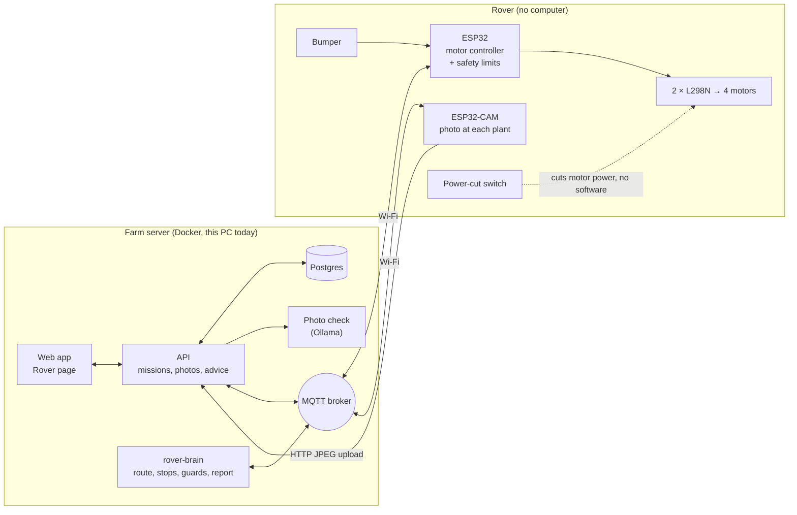
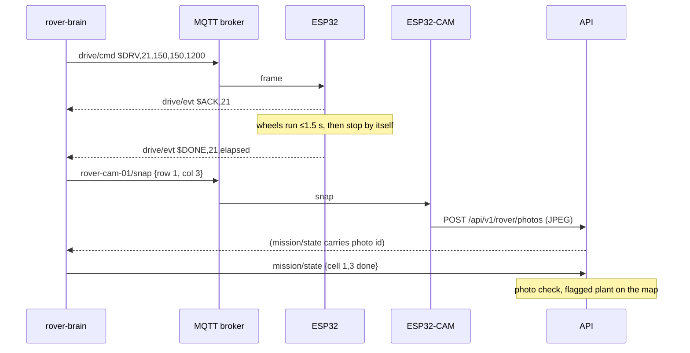

# AgriRover on an ESP32: system architecture

**Status: design, 2026-11-27.** The rover is built: an ESP32 drives two L298N boards (4 motors). The ESP32 runs
`rover_motor_controller.ino` over USB and answers the PC (tested). Nothing on this page beyond that is built yet.
It replaces the Raspberry Pi in [rover.md](rover.md): there is no computer on the rover, only the ESP32.

## The idea in one line

**The ESP32 is the rover's spinal cord, the farm server is its brain.** The ESP32 moves the wheels and keeps the
rover safe on its own. The server decides where to go, takes the photos' answers and writes the report. They talk
over Wi-Fi through the farm's MQTT broker, which is already running.

## Who does what

| Job | Runs on | Why there |
|---|---|---|
| PWM to the motors, direction pins | ESP32 | Needs hard timing |
| **Every safety limit**: max PWM 200, max 1.5 s per move, stop if no command for 2 s, bumper stops at once, motors off at boot and on Wi-Fi loss | ESP32 | Must hold when the server, Wi-Fi or broker is gone. Already in the firmware today |
| E-stop from the screen | ESP32 subscribes itself | Does not depend on rover-brain being alive |
| Online / offline | ESP32 (MQTT last will) | "Online" then means the rover itself, not a program on a PC |
| Battery voltage | ESP32 (GPIO 34, once the divider is fitted) | |
| Route planning, stop at each plant, turn to face it | rover-brain | Already written and tested in Python (`edge/rover-agent`). Too big to rewrite in C++ for no gain |
| Guards: rain, low battery, lost link, e-stop | rover-brain, *and* the ESP32 for lost link and e-stop | Two layers: the brain stops cleanly, the ESP32 stops anyway |
| Photo at each plant | ESP32-CAM | The main ESP32 has no camera and no room for one |
| Photo check, advice, reports, history | API (unchanged) | Already built |

**rover-brain is the existing rover agent, moved off the rover.** One class changes: `SerialDrive` sends drive
frames down a USB cable; a new `MqttDrive` sends the same frames over MQTT. The planner, mission runner, guards and
report stay as they are, with their tests. The API and the Rover page keep reading the same `mission/*` topics, so
they need no change.

## MQTT topics

Same broker, same device name (`ROVER-01`). New topics are in bold.

| Topic | From → to | Body | Retained | Note |
|---|---|---|---|---|
| `devices/rover-01/status` | **ESP32** → API | `{"status":"online","device":"ROVER-01","fw":"…","rssi":-61,"estop":false}`; last will `{"status":"offline"}` | yes | Moves from the agent to the ESP32. Power off or out of Wi-Fi → offline in ~8 s |
| **`devices/rover-01/drive/cmd`** | rover-brain → ESP32 | The frame used on USB today: `$DRV,12,150,150,1200*40`, `$STOP,13*36`, `$PING,14*39` | **never** | QoS 0. A retained drive command would replay at boot |
| **`devices/rover-01/drive/evt`** | ESP32 → rover-brain | `$ACK,12*XX`, `$DONE,12,elapsed*XX`, `$NAK,12,bumper*XX`, `$BAT,12480*XX` | no | |
| `devices/rover-01/estop` | API → **ESP32** and rover-brain | `{"estop":true}` | yes | Retained, so a rover that reboots comes up stopped |
| `devices/rover-01/mission/set` | API → rover-brain | unchanged | no | |
| `devices/rover-01/mission/state`, `mission/result` | rover-brain → API | unchanged | state: yes | |
| **`devices/rover-01/brain/status`** | rover-brain → API | online / offline (last will) | yes | So the page can say "rover online, brain not running" |
| **`devices/rover-cam-01/snap`** | rover-brain → ESP32-CAM | `{"missionId":"…","row":1,"col":3,"upload":"http://<server>:8000/api/v1/rover/photos"}` | no | |
| **`devices/rover-cam-01/status`** | ESP32-CAM → API | online / offline | yes | |

The drive frames keep their checksum and sequence number. The ESP32 drops a frame whose sequence number is not
newer than the last one, so a duplicate delivery can never repeat a move.

## One stop, step by step

**Latency budget.** On a farm LAN an MQTT round trip is about 10–50 ms. Every move is at most 1.5 s and is
acknowledged, so Wi-Fi delay changes when a move starts, never how long it runs. At 0.2 m/s, 50 ms is 1 cm.

## When something fails

| Failure | What stops the wheels | How fast | What the page shows |
|---|---|---|---|
| Wi-Fi drops, or the rover drives out of range | ESP32: no frame for 2 s → motors off; Wi-Fi lost → motors off | ≤ 2 s | Rover offline (last will) |
| Server, broker or rover-brain crashes mid-move | ESP32: the move ends itself (≤ 1.5 s); watchdog | ≤ 2 s | Brain offline / round failed |
| Bumper hits something | ESP32, at once; new moves refused while pressed | < 10 ms | Round stopped: bumper |
| E-stop pressed on screen | ESP32 directly, and rover-brain aborts the round | one MQTT hop | E-stop on |
| ESP32 crashes or browns out | Motors lose PWM → stop. It reboots with motors off and reads the retained e-stop | at once | Rover offline, then online |
| Something runs away anyway | **Power-cut switch on the rover** cuts motor power with no software | by hand | — |
| Battery low | rover-brain ends the round at 11.1 V (needs the divider on GPIO 34) | next stop | Battery low |

The order of authority stays the same as in [control-hierarchy.md](control-hierarchy.md): the hardware switch
beats the firmware, the firmware beats the server, and nothing upstream can ask for more than the firmware allows.

## The ESP32 firmware

One sketch, `rover_motor_controller.ino`, with two ways in:

- **Wi-Fi + MQTT (normal):** joins the farm Wi-Fi, connects to the broker with its own username and password,
  subscribes to `drive/cmd` and `estop`, publishes `drive/evt` and `status`.
- **USB serial (bench and rescue):** the same frames, exactly as today. Useful at the desk and if Wi-Fi fails.

Both feed the same `drive::parse()` and the same limits. Also:

- `secrets.h` (git-ignored) for Wi-Fi and broker details, as the field node does.
- Over-the-air updates (ArduinoOTA, password-protected), so the rover need not come back to a USB cable.
- Wi-Fi is reconnected in the background; the motors never wait on it. `loop()` keeps running the safety checks
  first, as now.
- Libraries: `PubSubClient` (already used by the field node) and the ESP32 core's `WiFi` and `ArduinoOTA`.

Pins: one ESP32 pin for each L298N pin, drawn in [rover-wiring.svg](../hardware/rover-wiring.svg) and listed in
[ROVER-PARTS.md](../ROVER-PARTS.md#what-the-code-already-fixes). The firmware keeps them as a pin map it can save
(`$MAP`), so a rover wired differently needs no new firmware. Bumper D4, battery D34.

## The camera

The plant check needs a photo at every plant. **Recommended: an ESP32-CAM (OV2640)** on a short mast, facing the
side the plants are on. It joins the same Wi-Fi, takes a photo when rover-brain asks, and uploads the JPEG to the
API over HTTP: MQTT is a poor fit for 100–200 kB images. The API stores it the way it stores rover photos today
(`services/rover_photos.py`), and the photo check runs as now.

At 1600 × 1200 a tomato leaf from 30–40 cm is sharp enough for the photo check. The real limit is light and focus:
test it on the demo bed before building around it.

## Security

The broker accepts anyone today (`allow_anonymous true`). With a rover that moves on Wi-Fi, that means anyone on
the network can drive it. Before it leaves the desk:

1. Give the broker a password file: one user each for the API, rover-brain, the ESP32 and the ESP32-CAM.
2. Restrict topics per user (an ACL): only rover-brain may publish `drive/cmd`.
3. TLS on port 8883 when the farm network is not yours alone.

## What changes in the code

| Where | Change | Size |
|---|---|---|
| `edge/rover-motor-controller` | Wi-Fi + MQTT alongside serial, sequence check, status with last will, OTA, `secrets.h.example` | Medium |
| `edge/rover-agent/rover/drive.py` | `MqttDrive`: the same interface as `SerialDrive`, frames over MQTT. Tested against a fake broker | Small |
| `edge/rover-agent` → rover-brain | `python -m rover brain`: runs on the server, no serial port. Publishes `brain/status` | Small |
| `docker-compose.yml` | A `rover-brain` service, always on (replaces the `rover-sim` profile in daily use) | Small |
| `apps/api` | Read rover and brain status separately; `POST /api/v1/rover/photos` for the camera | Small |
| `apps/web` Rover page | Show "Real rover" by default; status for rover, brain and camera; drop "Simulated wheels" from the daily round | Small |
| ESP32-CAM sketch (new) | Wi-Fi, MQTT `snap`, HTTP upload | Medium |
| Simulator | Stays, for tests and rehearsals only: not offered on the Rover page | — |

## Build order

1. **Firmware on Wi-Fi.** ESP32 publishes `status` and answers `PING` over MQTT. Test: unplug it → the page says
   offline.
2. **MqttDrive + rover-brain.** `jog` over Wi-Fi with the wheels lifted, then on the floor. Calibrate speed and turn
   (`ROVER_MPS_AT_CRUISE`, `ROVER_DPS_AT_CRUISE`).
3. **A real round without photos** on the demo bed, started from the Rover page.
4. **Broker passwords and ACL**, before anyone else is on the network.
5. **ESP32-CAM**, then rounds with the photo check.
6. **Battery divider and bumper** fitted, and the low-battery guard tested.
7. Later: wheel encoders so the rover drives by distance, not by time.

## Decisions to confirm

1. **Camera:** ESP32-CAM (recommended, about USD 8–10), or a phone on the rover, or no photos for now.
2. **Wi-Fi coverage:** walk the demo bed with a phone. The rover stops wherever the signal drops for 2 s.
3. **Keep USB as a second way in:** recommended for bench tests; it costs nothing.
4. **Where the server runs at the farm:** this PC for the demo; a mini PC or Pi at the farm later. rover-brain runs
   wherever the server does.
